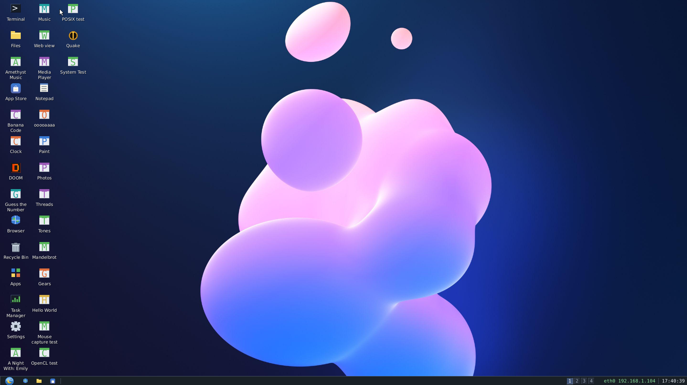

# 🍌 Banana OS 0.6

Banana OS 0.6 is a minimal x86 operating system written from scratch (no Linux kernel, no external OS kernel) - a **64-bit (x86_64) kernel with a 32-bit fallback**, booting on **UEFI and BIOS** machines and in VirtualBox/QEMU with **its own boot loader** (Banana Boot, Multiboot2) - now with **real networking**: its own drivers for the Intel e1000, AMD PCnet, virtio-net and Realtek RTL8139 network cards (every card VirtualBox offers) and its own TCP/IP stack, so `ping`, `curl` and `wget` talk to the actual Internet (HTTP and HTTPS).

```
  ____                               ____  ____
 | __ )  __ _ _ __   __ _ _ __   __|  _ \/ ___|
 |  _ \ / _` | '_ \ / _` | '_ \ / _` | | \___  \
 | |_) | (_| | | | | (_| | | | | (_| | |___)  |
 |____/ \__,_|_| |_|\__,_|_| |_|\__,_|___/____/
```



## Latest additions

- **RAM reporting above 3 GiB (build 169)** - Settings and neofetch use the full firmware memory map, including usable RAM above 4 GiB, even when the loader puts the legacy memory count first. Reserved regions and PCI holes stay excluded; neofetch and Settings show the same total. Run `selftest ram` to check map ordering, large totals, malformed input and live accounting.
- **Graphical boot menu (build 168)** - BIOS and UEFI share a dark menu with antialiased DejaVu text, a yellow focus highlight, display-size selection and a countdown bar. All five kernel choices and available firmware actions remain; any key pauses automatic start. Firmware without a usable framebuffer gets the text menu. Run `selftest boot` for safe renderer checks. QEMU BIOS and 64-bit UEFI menu/navigation/kernel-handoff tests pass; both UEFI architectures compile and pass relocation checks.
- **Mouse capture for games (build 167)** - native apps can hide and capture the cursor, receive raw relative movement past the desktop edges, and track all three mouse buttons and the wheel. Escape, focus loss, minimize, desktop switching and app exit release capture. Run `selftest mouse`; from a desktop terminal run `selftest mouse demo` for a look-around window (click to capture, Escape to release, Q to quit). The SDK exposes `bwin_capture_mouse()` and `bwin_mouse_captured()` (API 20). Host tests and both kernel builds pass; the user confirmed the mouse checks and interactive demo in a VM. Physical hardware remains untested.
- **Shared libraries: `dlopen`** (build 166) - the last piece of the POSIX layer for OpenJDK: `<dlfcn.h>` and `<link.h>`. Apps can load `.so` libraries built with `gcc -shared -fPIC`. Libraries can depend on each other, have constructors, and call the C library and the app's own functions: every SDK app now carries a table of its symbols. There are also `dlsym`, `dladdr`, `dl_iterate_phdr` and `dlclose`. Tested in QEMU on 64-bit and 32-bit: 7 of 7 `dlopen` checks; `posixtest` 60/60 (64-bit) and 48/48 (32-bit), and the whole `selftest` passes. The POSIX layer (mmap, threads, sockets, signals, dlopen) is now complete enough to start porting OpenJDK 17 (Zero interpreter, 64-bit).
- **Signals** (build 165) - the fourth piece of the POSIX layer for OpenJDK: `<signal.h>`, with `sigaction`, masks, `kill` / `raise` / `pthread_kill`, `sigaltstack` and `sigsetjmp` / `siglongjmp`. On the 64-bit system a crash in an app's own code is no longer the end: a bad memory access, a division by zero or an invalid instruction goes to the app's `SIGSEGV` / `SIGFPE` / `SIGILL` handler, with the fault address and the registers in a `ucontext_t`, which the handler may change to resume elsewhere (Java needs this). Signals sent between threads arrive at the next system call or timer tick and wake sleeping threads. Ctrl+C becomes `SIGINT` for apps that handle it. Tested in QEMU: 12 of 12 signal checks on 64-bit, including recovering from a bad write, from writing a read-only `mmap` page, and from a thread's stack overflow on an alternate stack; `posixtest` 53/53 (64-bit) and 41/41 (32-bit, where only `raise` reaches handlers), and the whole `selftest` passes.
- **BSD sockets** (build 164) - the third piece of the POSIX layer for OpenJDK: `<sys/socket.h>`, `<netinet/in.h>`, `<arpa/inet.h>`, `<netdb.h>`, `<poll.h>`, `<sys/select.h>`. Apps can use TCP and UDP over IPv4, through the loopback or out to the network. A socket is a file descriptor, so `read`, `write`, `close`, `poll` and `select` work on it. There are non-blocking sockets, receive and send timeouts, `getaddrinfo` over the system's DNS, and `inet_pton` / `inet_ntop`. The kernel now handles 64 TCP connections and 16 listening ports, up from 16 and 4. Tested in QEMU, 64-bit and 32-bit: a 100 KB echo through the loopback, UDP, `poll` / `select` / `FIONREAD`, timeouts, a refused connection, and an HTTP request to example.com (`posixtest` 41/41 and 39/39), and the whole `selftest` still passes. IPv6 sockets are not supported yet; Java falls back to IPv4.
- **POSIX threads** (build 163) - the second piece of the POSIX layer for OpenJDK: `<pthread.h>`, `<semaphore.h>` and `<sched.h>`. Threads can have any stack size (mapped, with a guard page) and can be joinable or detached. There are mutexes (recursive, error-checking, timed), condition variables (on the monotonic clock too), read-write locks, once, keys with destructors, barriers and semaphores. On 64-bit, `__thread` variables work: the kernel now keeps a thread pointer (FS) per thread. `errno` is per thread, and there are `clock_gettime`, `nanosleep`, `sysconf` and `getpid`. `banana_thread` uses the same threads. Tested in QEMU with `selftest posix`: 28 of 28 checks on 64-bit with 4 cores (8 threads x 20 000 increments under a mutex, 150 detached threads, a 4 MiB stack), 26 of 26 on 32-bit (no `__thread` there), and the whole `selftest` still passes on both.
- **`mmap` for apps** (build 162) - the first piece of a POSIX layer for ported programs, the way towards OpenJDK 17: `<sys/mman.h>` has `mmap`, `munmap` and `mprotect`. On the 64-bit system each app has 2 TiB of virtual addresses of its own: a mapping only reserves them, and a page gets memory (zeroed) the first time it is touched, so a program can reserve a 1 GiB heap and pay for the few megabytes it uses. `PROT_NONE` / `PROT_READ` are enforced, `MAP_FIXED` replaces a range with fresh pages, files can be mapped, and system calls accept mapped buffers. New: `selftest posix`. Tested in QEMU, 64-bit with 4 cores: all 12 checks, including 4 threads faulting pages in at once on different cores, and the whole `selftest` still passes. On 32-bit, 11 checks pass: there is no paging there, so there is no reservation or protection.
- **Updated systems get the new built-in apps** (build 161) - an app that comes with Banana OS is now upgraded at boot when its package changed, not only when its version number did: the App Store was rewritten in build 140 still as version 1.0, so a system installed before and then `update`d kept the old one. `/etc/builtin-apps` now records each package's CRC-32C. On the first boot after the update, each built-in app is installed again once. An app you uninstalled stays uninstalled. Tested in QEMU: an installed system with an old-style list and a damaged App Store got the right App Store back, kept Music removed, and the next boot reinstalled nothing.
- **App manager in Settings** (build 160) - Settings has a new **Apps** page: every installed app with its version, category, size on disk, and whether it is running or has an update. Select one to **Open** it, **Stop** it (every copy that runs), **Update** it (when a source has a newer version: it downloads in the background, the window keeps working) or **Uninstall** it (a second click confirms; a running app is stopped first). **App Store** opens the store to get more. The Apps launcher's *Details* opens this page on that app, and so does `settings apps [name]` in a terminal. Tested in QEMU on both kernels: open, stop and uninstall. The Update button has not been tried yet: no source had a newer version.
- **Choose the apps at install time** (build 159) - *Install Banana OS* has an **Apps** page: **Full** (every app: App Store, Media Player, Music, Photos, Amethyst Music, Banana Code and the example apps - recommended), **Standard** (the everyday apps: App Store, Media Player, Music, Photos) or **Minimal** (the App Store only, the lightest system); in the shell, `install --full` (the same as `install` alone), `install --standard` / `install --minimal`. What a profile leaves out is not lost: the apps and the examples that come with Banana OS are now a package source of their own, **`builtin:`** - built into the kernel, no network - so the App Store (*Discover*) and `apt install amethyst` put any of them back, and a left-out app does not come back by itself at the next boots. On systems from before, `builtin:` replaces the `~/Examples` source (the same packages). Tested in QEMU: `install --minimal`, booted from the disk - only the App Store - then `apt install amethyst`, and after another boot exactly those two

- **A real window manager** (build 157) - every window - terminals, Files, the Browser, Notepad, Settings, the installed apps' windows - is now in **one stacking order**: a click raises whatever is under the mouse, and when the front window closes or is minimized the next one down gets the keyboard (terminals used to sit above every app window but the front one). **Snapping**: drag a window by its title bar to the left or right edge of the screen and it takes that half (near a corner: that quarter), to the top edge and it fills the screen - a blue outline shows where it will go before you let go; drag it away and it gets its own size back. **Win+Left / Win+Right** snap the front window to a half (and back), **Win+Up** maximizes it, **Win+Down** restores it or minimizes it. **Right-click a title bar** for the window's menu: Restore, Minimize, Maximize, Snap left / right, *Always on top*, *Move to desktop N*, Close. **Alt+drag** moves a window from anywhere inside it. **Four virtual desktops**: the switcher on the taskbar (a dot under the desktops that hold windows), **Win+Ctrl+Left / Right** to go from one to the next (*Desktop 2* shows for a moment), **Win+Ctrl+Shift+Left / Right** to take the front window along; each desktop has its own taskbar buttons, new windows open on the desktop shown. Windows get a soft **shadow**. Tested in QEMU: snapping by drag and by keys, the window menu, switching desktops and back

- **Choose the disk to install on** (build 156) - the installer no longer needs every other disk detached. *Install Banana OS* lists every hard disk (IDE, SATA, NVMe, virtio) with what is on it - *empty*, *Banana OS is installed on it*, *too small*, or its partitions in orange (*3 partitions: FAT32 (LBA), ...*) - and you pick one: an existing install is chosen by default (to update), else an empty disk. Only that disk is erased (the confirmation says what is on it now), the others are not touched. In the shell, `install` lists the disks with a number and `install 2` installs on the second; `update 2` likewise when several disks hold Banana OS. Tested in QEMU with a blank IDE disk beside a SATA and a virtio disk full of files: installed on the IDE disk, booted from it, the other two mounted with their files intact
- **Every drive in Files** (build 155) - the navigation pane's *Computer* lists every mounted drive under *Local Disk (/)*, not only `/mnt/usb`: each partition of each disk, stick and card, by its volume label and folder (*DATA (sata2)*, *MYSTICK (usb)*; a drive without a label says what it is - *SATA disk (sata)*, *SD card (sd)*), with a USB icon for sticks and cards, kept up to date as drives come and go. The pane scrolls with the wheel when they do not fit. Right-click in a drive: *Eject this drive*; *Properties* there gives its filesystem, free space and size
- **Several disks** (build 154) - Banana OS used to want exactly one hard disk: with a second one attached, an installed system found no disk to load and started empty. Now every disk is looked at: the one holding Banana OS is the system's (never mounted), every other one is a drive - **extra IDE and SATA disks too**, not only USB sticks, NVMe and virtio - and **every volume on it is mounted**, not only the first: each MBR partition (primary and **logical**, through the extended partition's chain) and each GPT partition gets a folder of its own (`/mnt/sata`, `/mnt/sata2`, `/mnt/virtio`...; up to 16 drives and 16 mounts). **`lsblk`** shows the drives as a tree - their partitions, sizes, filesystems, mount points, MBR / GPT types and GPT names. `mount sata1p2 /mnt/data` mounts one partition where you want it, `mount sata1` a drive's volumes again, `umount sata1` all of a drive's volumes at once. Tested in QEMU: a SATA disk with one primary and two logical FAT32 partitions and a virtio disk with two GPT partitions, on the live CD and beside an installed system - all mounted, written to (Linux reads the files back), unmounted and mounted again
- **A new help** (build 153) - every command has a page now, like `man`: `help chmod`, `man chmod` or `chmod --help` show its synopsis, what it does, its options, examples and related commands. `help` alone lists the commands by topic (files, text, disks, system, network, servers, apps, desktop, hardware, sound, shell, vm), `help network` a topic's commands with a line each, `help -k disk` (or `apropos disk`) searches them, `help -a` lists all of them (with a pager on the screen; `help -a > file` writes the plain list). A mistyped command gets **Did you mean: ...?** (`lss` - `ls`, `chmdo` - `chmod`). `help --check` lists any command the shell knows that has no page (none today: 131 pages)
- **Guest tools for virtual machines, built in** (build 152) - what VMware Tools, VirtualBox's Guest Additions and the QEMU guest agent do, without installing anything. Banana OS knows which hypervisor it runs on (KVM, QEMU, VMware, VirtualBox, Hyper-V, Xen, Parallels, bhyve) and: **QEMU / KVM / Proxmox VE** - answers the **QEMU guest agent** (a virtio-serial driver, port `org.qemu.guest_agent.0`): Proxmox shows the VM's IP addresses, *Shutdown* and *Reboot* shut it down cleanly (files saved first), the clock is set after a resume (`guest-set-time`), and backups freeze the filesystem (`guest-fsfreeze-*`: everything written, then no writes until thawed; thawed by itself after 10 minutes); `guest-ping`, `-info`, `-get-osinfo`, `-get-host-name`, `-get-time`, `-network-get-interfaces`, `-get-vcpus`, `-get-fsinfo` too. Nothing that runs commands or touches files is there. **VMMouse** (VMware, and QEMU's vmport): the pointer follows the host's - no capture, no Ctrl+Alt to get out. **VMware** - the tools channel (TCLO/RPCI): *Shut Down Guest* / *Restart Guest*, the guest's IP and OS in vSphere / Workstation, the host's clock. **VirtualBox** - its VMMDev: mouse integration and the host's clock. `vmtools` shows all of it, `vmtools time` compares the clocks, `vmtools off` turns it off from the next start. Tested in QEMU (Proxmox's guest agent setup): every agent command above, a real shutdown through the agent, and VMMouse moving the desktop's pointer to the host's place; the VMware channel and VirtualBox's VMMDev are written to their specifications and not yet tried on those hypervisors
- **An ext4-class filesystem** (build 151) - the installed disk's filesystem now does what ext4 does for a desktop: **file names up to 255 bytes** (were 31) and paths up to 511, **Unix permissions and owners** on every file and folder (`ls -l` shows `-rw-r-----  banana banana`; `chmod 640`, `chmod u+x,go-w`, `chown root:banana`, `chgrp`; a file without its `w` bit cannot be changed, a folder without it cannot have things made, deleted or renamed in it), **symbolic links** (`ln -s`, `readlink`; `cd`, `cat`, `cp`, Files and apps follow them, `rm` and `mv` act on the link), **three dates** per entry with ext4's *relatime* for the access time, **CRC-32C checksums** (ext4's metadata checksum) on the metadata and every file written, room for **1,048,576 files and 262,144 folders** (were 65,536 / 16,384) and **files up to 2 GiB** (were 128 MB). Saves stay copy-on-write - new data never goes over the copy the last save points at - so a power cut at any moment leaves the previous save whole, which is what ext4's journal is for. `fsck` checks the tree, both metadata copies and the extents (`fsck -f` also reads every file back against its checksum, `fsck -y` repairs the tree), `stat` shows everything about one entry. Disks from earlier builds are read as they are and written in the new format (metadata version 7) from their first save on; FAT32 and exFAT volumes have no owners, modes or links, so `chmod`, `chown` and `ln -s` refuse there. Going back to an earlier build after that is not supported
- **Verbose kernel crash screen** - a blue stop-screen header and a dark diagnostic console show the stop code, exception/error details, full-width registers, CPU/task/uptime, control registers and a bounded raw stack snapshot. Page faults explain the attempted access and protection bits. The fatal path draws directly to the framebuffer and sends the full report to COM1, without entering the desktop or allocator. `crashtest` previews it safely; Enter/Esc returns to the OS. `crashtest report` prints a simulated report. Explicit `crashtest panic`, `ud2` and `pagefault` modes halt the OS for testing (save work first).

- **Browser crashes stay in the browser** - the web engine runs in the kernel, so a page that made it crash used to stop all of Banana OS. Now a crash in the browser (or in an app's web view) - a bad memory access, an invalid instruction, a too-deep recursion running off its stack (guard pages under it now) - closes only the page that caused it: the tab says *This page crashed the browser's engine*, the other tabs and the rest of the system go on. `about:crash` crashes the engine on purpose, to see it
- **Several keys at once (games)** - the keyboard driver keeps every key held down (PS/2, USB, Remote Desktop). Apps ask `banana_key_down('w')`, `banana_key_down(BANANA_KEY_LEFT)`... (API version 14) and web pages get a real `keydown` when a key goes down and `keyup` when it comes up, with `event.code`, so W + D + Space together work
- **App Store: your own servers** - *Servers* lists the repositories and adds one (its address and signing key, or trusted without a key after a warning) or removes one (API version 15). The App Store is pinned to the taskbar next to Files
- **Tests inside Banana OS** - run `selftest` for user mode, memory above 4 GiB, app/thread/file limits and concurrent allocation across cores; select a part with `selftest ring3`, `memory`, `limits` or `cores`. Run `fstest /mnt/virtio` (or your drive's mount point) for FAT32/exFAT writes, appends, Unicode names on exFAT, growing folders, deletion and reading everything back after a remount. `fstest -k` keeps its test folder. Both commands have passed in a VM; `selftest` reported nine checks passed. The tests also caught and helped fix a thread-return bug and an SDK allocation-boundary crash.
- **exFAT** - the format of SD cards over 32 GB (SDXC) and many USB sticks: read and write, Unicode names (through the volume's own up-case table), new files in one run of clusters where there is room (a FAT chain where not), folders that grow, `df` and `mount` show it. Volumes with two FATs (TexFAT) are mounted read-only. The drives' partitions are now searched by one layer for every filesystem (`kernel/volume.c`): the whole device, then every MBR or GPT partition. `tools/test-exfat.sh` checks it end to end - Banana OS writes to an exFAT image in QEMU, then `fsck.exfat` and an exFAT reader of its own check the result on Linux
- **System calls on every core** (64-bit) - an app thread running on another processor core used to go back to the boot core for every call it made; now the calls that touch only its own things run right where they are made: `malloc` / `free` / `realloc`, `draw_text`, the clock, `thread_id`, `cpu_count`, the modifier keys, `wake`, and `wait` when there is nothing to wait for. The kernel heap, the RAM above 4 GiB, apps' page tables and each app's memory got locks for it; everything else in the kernel still runs on the boot core. Busy threads (OpenGL's `gears`, OpenCL's `cltest`, `threads`) stay on their cores
- **Higher limits** - 32 apps at once (was 8), 64 threads per app (16), 64 open files per app (16), 32 app windows (6), 32 web views (8) and 256 tasks (48): every task's stack is now allocated when it is created, so a free slot costs only its record
- **Memory above 4 GiB** (64-bit) - Banana OS used at most 3.5 GiB of RAM; now the RAM above 4 GiB (up to 512 GiB) is mapped at boot and apps' memory comes from it first, so a PC with 16 GiB has room for big apps without crowding the kernel. `free` and Task Manager count it. Try it in QEMU: `MEM=8G tools/dev.sh apps`
- **Apps are walled off from the kernel** (64-bit) - an app runs in ring 3, in an address space of its own: only its own memory (code, stacks, `malloc`, its windows' pictures) is open to it, so a wild pointer stops the app instead of damaging the kernel or another app. It calls the system through `int 0x80` (the call table it gets holds small stubs, so apps and packages built before work unchanged), every pointer it passes is checked to be its own memory, and the bookkeeping of its memory lives in the kernel, out of its reach. Its threads' system calls run on kernel stacks of their own (guarded), and other processor cores load its page tables too. `tools/dev.sh apps` boots Banana OS in QEMU and runs the examples over the serial console
- **`<iframe>` in the web browser** - a page can embed another page: the browser loads the frame's `src` (or its inline `srcdoc`) as a document of its own, lays it out and draws it inside the frame's box, clipped to it, with its own styles and JavaScript. Frames nest (a frame inside a frame), and buttons, checkboxes and `onclick` handlers inside a frame work. Each frame is sandboxed - it has no access to the page around it. (Scrolling a frame's overflow and following links inside it are not there yet.)
- **Remote Desktop (RDP)** - both a server and a client, speaking the Remote Desktop Protocol (MS-RDPBCGR) over its own TLS 1.2 (written from the RFCs, `net/tls12.c`). The **server** (`rdpd start`, port 3389, off by default like `sshd`) lets Windows' *Remote Desktop Connection* (mstsc), the Microsoft Remote Desktop apps and FreeRDP connect to the Banana OS desktop: it mirrors the screen and takes the keyboard and mouse. Log in as `banana` with the `passwd` password; an RSA key and certificate are made on first start and kept in `/etc/rdp/`. The **client** (`rdp host[:port]`, a desktop window) connects out to Windows, xrdp, FreeRDP or another Banana OS: it draws the remote screen (uncompressed, RDP 6.0 planar and interleaved-RLE bitmaps) and forwards the exact keys and the mouse, with **NLA** (CredSSP / NTLMv2) when a password is given. Both are in *Settings > Startup*. See [Remote Desktop](#remote-desktop-rdp)
- **Amethyst Music** - the app of [Amethyst Music](https://music.office-works.ch/): the server's whole catalogue streamed (songs are kept in `~/.cache/amethyst`, the next one is fetched while the current one plays, so there is no gap), with the covers (WebP), *Home* (recommendations, recently played, most played), *Songs*, *Albums*, *Artists*, *Playlists*, the queue, shuffle / repeat, an equalizer and a visualizer. The first time it asks for the server's address (any Amethyst server; e.g. `https://music.office-works.ch`) and, optionally, an account: log in (or create one) for your recommendations, history and play counts, and to make playlists (right-click a song > *Add to...*). The account box at the bottom of the sidebar changes both; it comes installed
- **Media Player** - videos and music through **FFmpeg** (7.1, ported to Banana OS: [ports/ffmpeg](ports/ffmpeg/build.sh)): MP4, MKV, WebM, AVI, MOV, MPEG, OGG, FLV, WMV with H.264, H.265/HEVC, VP8, VP9, MPEG-4 (DivX/Xvid), MPEG-1/2, Theora, WMV and AAC, MP3, Opus, Vorbis, FLAC, AC-3, ALAC sound. The picture keeps to the sound's clock (late frames are dropped), seek bar, pause, keyboard and media keys, album covers for songs. Double-click a video in Files, or `mediaplayer file.mp4`. On the 64-bit kernel FFmpeg's SIMD code (SSE2...SSE4) is used
- **Music** - a music library player after [Amethyst](https://github.com/Geoxor/Amethyst): the songs of `~/Music`, `~/Downloads`, the home folder and USB sticks with their tags and covers, *Songs* / *Albums* (a grid of covers) / *Artists* / *Liked songs* / *Queue*, search as you type, shuffle and repeat, **gapless** playback, a 6-band **equalizer** with presets, a spectrum **visualizer** (*Now playing*), and the media keys from anywhere on the desktop. (Amethyst itself is an Electron app - a whole Chromium - which cannot run here; this is a native player made the same way.)
- **Graphics drivers** - real drivers instead of only the firmware's framebuffer: **VMware SVGA II** (VMware, VirtualBox's VMSVGA / VBoxSVGA, QEMU `-vga vmware`), **virtio-gpu** (QEMU / KVM `-vga virtio` and `-device virtio-gpu-pci`, which has no firmware framebuffer at all), **Bochs / QEMU / VirtualBox VBoxVGA** (and `bochs-display`), **Intel GMA 950** and **HD Graphics 2000 / 3000 / 2500 / 4000** (Sandy Bridge, Ivy Bridge). Resolution changes, the mouse pointer drawn by the graphics card, vertical-blank waits and a laptop panel's backlight (`brightness`) where the card has them - see [Graphics drivers](#graphics-drivers); `lsgpu`, `resolution`
- **Driver Kit: drivers from hardware makers** - drivers are kernel modules built outside Banana OS with [sdk/driver](sdk/driver/banana_driver.h): a `.bpk` of type `driver`, installed with `pkg install`, loaded at every boot. PCI, ports, device memory, DMA memory, interrupts, tasks, and registering PCI drivers and displays - a display module replaces the built-in driver of its card. Two examples: a QEMU `edu` device driver and a display driver - see [Driver Kit](#driver-kit)
- **Function keys** - F1-F12, the Windows key (Start menu), Alt+F4 (closes the window in front; with none, *Shut down*), F11 (a terminal fills the screen), F2 / F5 in Files (rename, refresh), F5 in the browser, F3 in Notepad, and the **media keys** (laptops: Fn + F-key): volume up / down / mute work everywhere, with the level on the screen, play / pause / next / previous go to Music. PS/2 and USB keyboards; apps get `BANANA_KEY_F1`... and the media keys
- **`$PATH`** - commands that are not built in are looked for in the folders of `$PATH` (`/bin:/apps:/home/banana/bin` by default): programs (SDK ELF files) and shell scripts run by name, `/apps` holds the installed apps; `export PATH=...` changes it, `which` / `type` say where a command is
- **ACPI power-off** - `shutdown` and Start > Shut down turn the computer off the ACPI way (the FADT's registers and the DSDT's `\_S5_` sleep type, switching ACPI on first if the firmware left it off): VMware, VirtualBox, QEMU and real PCs
- **Secure Boot, 32-bit UEFI, more in the boot menu** - the UEFI loaders are signed with Banana OS's own key and boot with Secure Boot on once the key is enrolled: from the boot menu in Secure Boot's setup mode (*Enroll Banana OS's Secure Boot keys*), or by hand in the firmware's settings from `EFI/BananaOS/BananaOS.cer` on the CD or stick. Under Secure Boot the loader starts only the kernels it was built with (their SHA-256 is in it). `BOOTIA32.EFI` boots on 32-bit UEFI firmware (tablets, early UEFI PCs) - both kernels, the 64-bit one when the processor has long mode. The menu also has *Boot the next boot option* / *Boot from the next device*, *UEFI firmware settings* (restarts into the firmware's setup screen) and *Restart the computer* - see [Secure Boot](#secure-boot)
- **New in 0.6: apt and the App Store** - packages now come from **repositories**, like Debian's: `apt update`, `apt search`, `apt install <name>` (it installs what the app depends on first), `apt upgrade`, `apt remove`, `apt autoremove`, `apt list --upgradable`, `apt add-repo <url> key=<key>`. The **App Store** (desktop, Apps > *Get apps...*, or `store`) does the same with the mouse: Discover by category, search, an app's page with *Install* / *Open* / *Update* / *Remove*, Updates with *Update all*, Installed. Repositories are **signed** (Ed25519: a list whose signature does not match its key is refused, and every download must match the signed index's SHA-256). The examples that come with Banana OS are a repository of their own (`file:///home/banana/Examples`). See [Packages: apt and the App Store](#packages-apt-and-the-app-store)
- **New in 0.6: Intel e1000e and igb network cards** - the Intel Ethernet of most PCs: the **I217 / I218 / I219** built into Intel chipsets (laptops and desktops since 2013), 82571-82574 and 82583 (e1000e), and **I210 / I211 / I350 / I354**, 82575 / 82576 / 82580 (igb, many boards and server cards) - next to the classic 8254x. The PHY is woken and auto-negotiation started by the driver. Tested in QEMU (`-nic user,model=e1000e`, `model=igb`): DHCP, ping, HTTP on both kernels
- **New in 0.6: OHCI USB, USB tablets and touchscreens** - a driver for OHCI, the USB 1.1 controller of AMD / SiS / ALi / NEC chipsets, add-in cards and VirtualBox (its default USB controller): keyboards, mice, hubs, sticks on it. USB pointers are now read through their report descriptor too, so **tablets** - VirtualBox's *USB Tablet* and QEMU's `usb-tablet`, the pointer that simply follows the host's mouse, no capture - and **touchscreens** put the pointer where they say (absolute), and mice that do not speak the boot protocol work
- **New in 0.6: OpenCL** - apps can run OpenCL 1.2 programs: `#include <CL/cl.h>` and `USE_CL = 1`. The platform *Banana OS OpenCL* has one device, the processor with all its cores: `clBuildProgram` compiles the kernels' OpenCL C **on Banana OS, inside the app** (with TinyCC, into memory), and `clEnqueueNDRangeKernel` shares the work-groups out between every core. Buffers (create, read, write, copy, fill, map), 1D/2D/3D ranges with or without a group size, `__local` arguments, build logs with line numbers, `-D` options, events with profiling, and in OpenCL C the address space qualifiers, the work-item functions, the math built-ins, `min`/`max`/`clamp`/`mad`/`mix`, 32-bit `atomic_*` and `printf`. `barrier()` synchronizes work-items and shares `__local` arrays and pointer arguments within each group. Vector types include `float4`; images and samplers are not implemented. `selftest opencl` installs and runs the matching `cltest` example, including reductions, shared arrays, vectors, Mandelbrot, atomics and math
- **New in 0.6: OpenGL** - apps can draw 3D with the OpenGL 1.x API: `#include <GL/bgl.h>` and `USE_GL = 1` in the Makefile. Matrices and GLU (`gluPerspective`, `gluLookAt`), immediate mode, vertex arrays, display lists, lighting (8 lights, materials, color material), textures (RGB/RGBA/luminance, nearest / linear, repeat / clamp / mirrored), depth buffer, blending, alpha test, fog, scissor, culling, wireframe, lines and points, `glReadPixels`; constants have their standard values, so GL 1.x code ports as it is. It is Banana OS's own renderer, in software on the processor: the frame is shared out between **all the cores** (each draws every n-th row, so the picture is exactly the one-core picture). **Gears** (`~/Examples/gears.bpk`, or the App Store) shows it - the frame rate is in its title. There is no GPU 3D: AMD / NVIDIA / Intel cards would each need a driver the size of Mesa's
- **New in 0.6: the Banana OS package server** - `tools/repo/banana-pkgd` runs a repository as a service on Linux: what `apt` and the App Store fetch, web pages listing the packages (search, a page per app with the `apt add-repo` line), and **uploads with tokens** - `banana-repo push https://your.server app.bpk --token ...`, or its `/upload` page (from Banana OS's browser too). Each upload is checked, published and the index signed at once; `install-server.sh` sets it all up (systemd, nginx, HTTPS)
- **New in 0.6: host your own repository on Linux** - `tools/repo/banana-repo` (Python 3, nothing else) makes one (`init`, `add app.bpk`, `remove`, `list`, `verify`, `key`) and serves it (`serve`); `tools/repo/install-server.sh` sets up a server - nginx (or a systemd service), HTTPS with Let's Encrypt - on Debian, Ubuntu, Fedora or Arch. Apps say their category, what they depend on and their picture in their Makefile (`CATEGORY`, `DEPENDS`, `ICON`); an app's `icon.png` is also its icon on the desktop, the taskbar and the Start menu
- **New in 0.6: uploads in the browser (catbox.moe)** - `<input type="file">` works: clicking it (or the drop area of an upload site - catbox.moe, Dropzone, a `<label>` for a hidden one) opens **Choose a file to upload** over the page; the file goes to the page as a real `File` (`files`, `name`, `size`, `type`, `text()`, `FileReader`) and is sent as `multipart/form-data` by `fetch`, `XMLHttpRequest` (with `upload` progress events) and plain forms. A page can only ever read the files you chose for it. **jQuery 3.7** now runs (array methods on array-like objects, `F[key] = ...` on functions, JavaScript's left-to-right order in `a.b = c`, `document.implementation`), `document.readyState` goes *loading - interactive - complete* (scripts that wait for DOMContentLoaded start), and blocks inside `<center>` are centered
- **New in 0.6: the browser and Bing** - searching from Bing's home page works (one-line search boxes made of a `<textarea>`, as Bing and Google have, submit on Enter), `<base href>` and `data:` URLs (pictures, scripts, fetch), `Function.prototype.toString`, `in` inside a `for (...)` head's parentheses, and a layout fix for nested flex rows that made headers and some tables (Hacker News) far too wide or squeezed
- **New in 0.6: a real desktop, drag and drop, the Recycle Bin** - the desktop shows the files and folders of `~/Desktop` beside the programs (double-click opens them; right-click: Open, Show in Files, Cut, Copy, Delete, Rename; on the desktop itself: New folder, New text document, Paste, Arrange icons) and **icons stay where you drag them**. **Drag a box** to select several (desktop and Files; Ctrl+click adds one, Shift+click a range, Ctrl+A all). **Drag and drop**: files between Files' folders (onto a folder row or a place of the left pane), from Files onto the desktop and back, onto a desktop folder, onto a program's icon (it opens the file), onto the **Recycle Bin**; Ctrl held copies. **Delete** moves things to the Recycle Bin (`~/.Trash`; Shift+Delete, and on USB sticks: for good after asking); the Recycle Bin (desktop icon, Files' left pane) shows them with *Restore* (back where they were) and *Empty Recycle Bin*. Names starting with a dot are hidden in Files (Organize > Show hidden items)
- **New in 0.6: pin apps to the taskbar, icons-only or titles-only taskbar** - pinned programs sit right of Start (Browser and Files to begin with; a line under one shows it is open): right-click a window's taskbar button or an app's desktop icon - *Pin to taskbar*, right-click a pinned one - *Unpin*. **Settings > Taskbar** (or the taskbar's menu): *Icons and titles*, *Icons only*, *Titles only*
- **New in 0.6: the whole desktop by keyboard** - **Alt+Tab** (the window switcher; Shift goes back), **Win+Tab** (task view: every window as a card - arrows, Enter, Delete closes one), **Win+D** (the desktop: then the arrows go through its icons, Enter opens, the Menu key shows an icon's menu), **Win+T** (the taskbar's buttons), Win+E Files, Win+I Settings, Win+R a terminal, Win+L lock, Win+M / Win+Down minimize, Win+Up bring back, Win+1...9 the taskbar's windows, Ctrl+Esc the Start menu, the **Menu key** or Shift+F10 (right-click menus, which the arrows and Enter drive). In **Settings, Task Manager and Apps**, Tab / Shift+Tab and the arrows move a yellow focus ring between the controls and Enter or Space presses them (Settings' file chooser: arrows, Enter, Tab through the places). Files, Notepad, the Browser and the Start menu had their keys already
- **New in 0.6: AMD, NVIDIA and Intel Arc / Xe graphics** - recognized by family (`lsgpu`, Settings > About: "NVIDIA GeForce RTX 30 series (Ampere)", "AMD Radeon RX 7000 series (RDNA 3)", "Intel Arc A-series (Alchemist)"...) and their screen made **write-combining**: the firmware leaves video memory uncached, so every pixel drawn was a trip over PCIe of its own - drawing is now many times faster on real PCs with these cards. The screen size is chosen in the boot menu or Settings > Screen (see below); there is no mode-setting or 3D driver for them
- **New in 0.6: Banana Code** - a code editor in the spirit of VS Code, with a **C compiler inside** (TinyCC): Explorer, tabs, syntax colours (C, JavaScript, HTML, CSS, Python, JSON, shell, Makefile, Markdown), find / replace, search in files, a command palette (Ctrl+Shift+P), Problems and Output. *New App* makes a desktop or console app; **F7 builds it on Banana OS itself** into a `.bpk`, **F5 builds, installs and runs it**. *Port a Program* turns a folder of C files (an existing program) into a Banana OS app, and the Problems list shows what does not compile yet. See [Banana Code](#banana-code)
- **New in 0.6: extensions, and a Claude extension** - Banana Code extensions are HTML + JavaScript views (the system browser's engine) that talk to the editor: read the file and the selection, insert code, open files, run builds, keep settings and make web requests with any headers. **Claude** comes built in: chat with Claude about your code with your own Anthropic API key - *Explain*, *Fix build errors* (it gets the compiler's messages), *Port to Banana OS* (it knows the SDK), *Review* - and put its code into the editor with one click
- **New in 0.6: the screen size on any PC** - without a graphics driver for the card (most real PCs: recent Intel, AMD, NVIDIA) Banana OS used to keep the firmware's size. Now Banana Boot asks the firmware (UEFI GOP or BIOS VBE) which sizes it offers: the boot menu shows a *Screen:* line (Left / Right to change it for this start), and *Settings > Screen* (or `resolution WxH` / `resolution auto`) saves the choice on an installed system - it is written into the disk's boot loader settings and used from the next start. With a graphics driver (QEMU, VirtualBox, VMware...) the size still changes at once
- **New in 0.6: fonts and text size** - *Settings > Fonts*: install your own TrueType fonts (*Install font...*, or right-click / double-click a `.ttf` in Files; they are kept in `/usr/share/fonts`), choose the **interface font** (the whole desktop's text) and the **documents font** (web pages, apps, desktop icon names), and the **text size** - Normal, Large, Larger, Largest - for terminal windows, Notepad and the desktop icons' names
- **New in 0.6: your own wallpapers in Settings** - *Settings > Wallpaper* now has *Your pictures*: the pictures you used lately (from *Browse...*, Files' *Set as desktop background* or Photos) as thumbnails next to the presets, and the position (Fill, Fit, Stretch, Center)
- **New in 0.6: Photos** - double-clicking a picture in Files opens it in the new Photos app (it used to become the wallpaper): the other pictures of the folder with Left / Right, zoom with the wheel or + / - (drag to move), 1:1 / fit, rotate, *Set as wallpaper*
- **Our own boot loader: Banana Boot** - GRUB is gone. One image boots on **legacy BIOS and UEFI**, from a **CD, a USB stick or a hard disk**, and starts the **64-bit or the 32-bit kernel** (the same menu as before, 64-bit by default when the CPU can). On BIOS: a 440-byte MBR or a 2 KiB El Torito entry loads a 10 KiB loader that runs in 32-bit protected mode and calls the BIOS through a real-mode thunk; it reads the kernel from the ISO9660 file system and sets the VBE graphics mode. On UEFI: `BOOTX64.EFI` (10 KiB, our C, no EDK2/gnu-efi) reads the kernel from its EFI partition, takes the GOP framebuffer and the firmware's memory map, leaves the firmware and steps down from 64-bit long mode to 32-bit protected mode. Both hand the kernels exactly what GRUB did (Multiboot2), so nothing changed for them - see [loader/](loader/)
- **A much bigger filesystem** - up to 65,536 files and 16,384 folders (was 1,024 and 256), found by name through hash tables, so a folder of thousands of files lists and opens as fast as a small one; files up to 128 MB. On an installed disk, files are read in the first time they are used instead of all at boot: what you can store is no longer limited by the RAM, and boot does not slow down as the disk fills. IDE disks larger than 128 GB are used whole (48-bit addressing)
- **File data is a cache** - like other systems, files in RAM are a cache of what is on the disk: when memory runs low, the files used longest ago are dropped from RAM (only once saved; a file in use is never dropped) and read in again when next used. Big files are read in pieces straight from the disk - apps and `play` never need a whole file in RAM (a song streams 64 KiB at a time) - and saving no longer copies a changed file first. `free` counts the droppable file data as "available"
- **`df`, `free` and `htop`** - `df` shows the disk space (size, used, free; `-i` files and folders, USB sticks too), `free` the RAM, `htop` a colour `top` with a meter per processor core, memory and disk. `top` now counts the RAM correctly (it showed only the files' data as used)
- **Apps and a Linux SDK** - write apps in C on Linux with the SDK in [`sdk/`](sdk/README.md) (C library with `float`/`double` and `math.h`, windows - resizable ones too - drawing, mouse/keyboard events, files, sound, HTTP); one `make` builds them for both kernels into a `.bpk` package. Install with `pkg install app.bpk` or a double-click in Files, run them by name or from **Apps** on the desktop. Six examples come built in (`~/Examples`)
- **Crash-safe apps** - an app that crashes (bad pointer, division by zero, stack overflow...) is stopped with a message saying what happened, and the rest of the system keeps running; on the 64-bit kernel NULL pointers and stack overflows (guard pages) always fault. Every task's FPU/SSE registers are saved, so apps compute in floating point
- **USB sticks (FAT32)** - plugged-in sticks are mounted at `/mnt/usb`, read and write, long file names included; every tool works on them (`ls`, `cp`, Files, the browser, `pkg install`...). `umount` ejects
- **NVMe SSDs** - a polled NVMe driver: NVMe disks are install targets (and boot on UEFI), FAT32 partitions are mounted at `/mnt/nvme`
- **virtio disks** - virtio-blk (QEMU/KVM, Proxmox, cloud VMs): install targets like NVMe, FAT32 partitions mounted at `/mnt/virtio`; virtio disks and network cards work over the legacy and the modern (virtio 1.x only) interface
- **SD card readers** - SDHCI readers (PCI): SD, SDHC and SDXC cards are mounted at `/mnt/sd` when put in and unmounted when taken out
- **Firewall (optional)** - off unless turned on (`firewall on`, Settings > Network): connections from outside refused but for the ports allowed (`firewall allow tcp 22`), pings only if allowed, everything you start works as before; `firewall log` shows what was blocked
- **IPv6 (optional)** - off by default; `toggle6 [on|off]`, `ipv6 on/off` and Settings > Network control the same switch. Link-local/SLAAC addresses, neighbour discovery, ping, TCP, UDP and AAAA DNS. IPv4 stays independent. `curl -6` and `wget -6` select IPv6; bracket literal addresses, e.g. `http://[::1]:8080/`. Use `selftest ipv6` for local checks; it restores the previous toggle state without changing saved settings.
- **Intel Macs** - Apple keyboards (Command works as Ctrl), Apple NVMe SSDs (2015-2017 Macs, T2 Macs), the speakers of Macs' HD Audio codecs (GPIO amplifiers), and the Apple SMC's temperatures and fans in `sensors`
- **Android phones** - `adb` (devices, shell, push, pull, install, logcat, reboot) and `fastboot` (getvar, flash, erase, boot, reboot, oem, flashing unlock) over USB, with the phone's "Allow USB debugging?" key check (RSA-2048, the key in `~/.android`)
- **Drag and drop everywhere** - files dragged from Files or the desktop onto a terminal type their paths at the prompt, onto Notepad / the Browser open there, onto an app's window go to the app (Banana Code, Photos, Media Player, Music; API 13 `BANANA_EV_DROP`); held over a taskbar button, that window comes up to drop on
- **Game controllers** - USB gamepads and joysticks (HID: PlayStation, Logitech...), Xbox 360 and Xbox One / Series controllers, in one layout for apps (API 12, `banana_gamepad`); `gamepad` shows them
- **CPU temperature** - `sensors` and Task Manager show the processor's temperature (Intel digital thermal sensor, AMD Tctl; not in virtual machines)
- **Power button** - the ACPI power button (and VirtualBox's ACPI Shutdown, QEMU's `system_powerdown`) saves the files and shuts down
- **Sound** - Intel HD Audio (any codec: Realtek ALC, IDT/SigmaTel, Conexant, VIA... - every analog output, speakers and headphones together), AC'97 and USB audio (headsets, USB speakers, DACs) drivers (QEMU, VirtualBox, real PCs) and the PC speaker: `play file.wav`, `beep`, `volume`, and sound for apps
- **Windows-like taskbar** - a button per open window (click: focus, click again: minimize), minimize buttons, *Show the desktop*
- **Task Manager** - windows and apps (Switch to / End task), the kernel's tasks with their CPU use, live CPU and memory graphs; from the desktop, the Start menu or a right-click on the taskbar
- **Settings** - wallpaper, fonts and text size, screen resolution, sound volume, keyboard layout, mouse pointer speed, network, date & time and information about the computer (`settings` in a terminal); volume, layout and pointer speed are kept in `/etc/settings.conf`
- **Window buttons** - every window has minimize, maximize / restore and close buttons in its title bar
- **Right-click menus everywhere** - desktop, taskbar, terminals (copy, paste, clear), Files (open, install, rename, cut/copy/paste, delete, new file/folder, eject), the browser (open/save link, back, reload, page source...), Notepad
- **Browser downloads** - anything that is not a web page (apps, archives, programs...) is saved to `~/Downloads`; *Save link as* / *Save page as* in the right-click menu
- **UEFI fixes** - device registers above 4 GiB (where UEFI firmware puts NVMe, GPUs...) are mapped on demand, and the desktop uses whatever resolution the firmware gives (not only 800x600)

## What's new in 0.5

- **64-bit** - the kernel also builds for x86_64 (long mode, 4 GiB identity-mapped with 2 MiB pages); one ISO carries both kernels and its boot menu picks the 64-bit one when the CPU supports it, the 32-bit one otherwise
- **UEFI** - the ISO (and a disk made with `install`) boots on UEFI firmware as well as on BIOS; `neofetch` shows which one started it
- **Networking** - PCI NIC drivers (Intel e1000 - 82540EM / 82543GC / 82545EM, QEMU's default and VirtualBox's PRO/1000 cards; AMD PCnet-PCI II and PCnet-FAST III, VirtualBox's AMD cards; virtio-net, VirtualBox's paravirtualized card; Realtek RTL8139; Realtek RTL8111/8168, RTL8169 and RTL8101/8102, the gigabit Ethernet of most PC mainboards) and a from-scratch TCP/IP stack: Ethernet, ARP, IPv4, ICMP, UDP, DHCP, DNS and TCP (retransmission with RTT-based timeouts, fast retransmit, congestion + flow control, out-of-order reassembly)
- **`ping`, `curl`, `wget`, `nslookup`, `ifconfig`, `netstat`, `arp`, `dhcp`** - working against real hosts; a download whose connection breaks or stalls goes on where it stopped (HTTP `Range`), for curl, the browser and apps alike
- **USB** - xHCI, EHCI and UHCI host controllers and USB hubs (on EHCI/UHCI, including the hub Intel chipsets put behind every port), USB keyboards, mice and sticks, and USB network adapters: **Realtek RTL8152/8152B (Lanberg NC-0100-01)** and CDC-ECM; `lsusb`, hot-plug with `usb rescan`
- **HTTPS** - a TLS 1.3 client (X25519, AES-128-GCM, ChaCha20-Poly1305, SHA-256/HKDF, all written from the RFCs, with known-answer self-tests: `cryptotest`)
- **Your own wallpapers** - download a PNG/JPEG/BMP/GIF with `wget` (or `wallpaper url ...`) and use it; pick it in the Wallpaper app or with the `wallpaper` command. The choice is saved and survives reboots on an installed disk
- **Real files** - files are no longer capped at 2 KiB: data lives on a new kernel heap (up to 32 MiB per file), binary files are fine, and installed disks from 0.4 are upgraded automatically
- **Faster, cooler** - timer interrupts + `hlt` instead of busy polling: an idle Banana OS went from pinning a host CPU core at **100% to ~6%**; the console prints ~100x faster (an 8000-line file: 27.8 s -> 0.27 s); the desktop only repaints what changed
- **Serial console** - the shell also runs on COM1 (`-serial stdio`), which makes Banana OS scriptable and testable headless
- **SSH server** - log in from any SSH client (OpenSSH, PuTTY, Windows `ssh`) with the password you set with `passwd`: curve25519 key exchange, Ed25519 host key, ChaCha20-Poly1305 / AES-128-GCM, written from the RFCs
- **Web server** - `httpd start` serves `/var/www` (with folder listings) to any browser on the network
- **File explorer** - a "Files" window on the desktop: browse, preview text and pictures, new folder, delete, open in the editor or a terminal, set a picture as the wallpaper
- **Web browser** - a "Browser" window on the desktop with its own HTML parser, CSS engine, layout and renderer, and a small JavaScript interpreter with a DOM (`getElementById`, `innerHTML`, events, `setInterval`, ...); opens `http://`, `https://`, `file://` and `about:home`
- **Browser framework checks (build 166)** - offline React 18.3.1, Vue 3.5.13 and Alpine 3.14.9 counters with compiled Tailwind CSS 3.4.17, plus a real Astro 5.13.2 production build with Preact islands (`client:load`, `client:idle`, `client:only`). Open `about:frameworks` and follow its links; run `selftest browser` to check mounting, clicks, reactive styles, utility selectors, responsive layout, Astro output and MutationObserver inside the OS. Run `selftest browser swm` for the live SuperWebManager baseline (16 host checks pass, including WebP images and desktop grid). Latest layout/image fixes await VM confirmation. These demos cover a subset; Tailwind v4 and the CDN compiler are not verified. See [fixture sources and host tests](web/fixtures/README.md).
- **PHP** - `httpd` runs `.php` pages (`$_GET`, `$_SERVER`, `header()`, ~90 functions, files) with the same interpreter; try `http://localhost/demo.php`
- **Permanent settings** - the network configuration (static IP or DHCP, chosen interface) and the servers to start at boot are saved in `/etc` and applied at every boot of an installed system
- **Shell** - output redirection (`cmd > file`, `cmd >> file`) and command lists (`a; b`, `a && b`)
- **SATA** - an AHCI driver next to the IDE one: SATA hard disks and SATA CD/DVD drives (QEMU `-machine q35`, VirtualBox's SATA controller); `install`, `sync` and booting from the disk work on either; `disks` lists them
- **Resizable windows** - terminals, Files, Browser and Notepad resize from their bottom-right corner, and a double-click on a title bar maximizes / restores; a terminal's shell and the editor follow its new size
- **Copy and paste** - one clipboard for the whole desktop: drag over a terminal's text to copy it and right-click to paste; Ctrl+C / Ctrl+X / Ctrl+V in Notepad, the editor and the browser
- **Notepad** - a GUI text editor window (`notepad [file]`, the desktop, or double-click a text file in Files): mouse selection, scrollbars, Open / Save / Save as / Find
- **Browser tabs** - up to 8 tabs (Ctrl+N, Ctrl+W, right-click a link to open it in a new one), a cookie jar, POST forms, and a much bigger web engine (below) for real-world pages
- **Expose a local server to the internet** - `httpd expose` asks your router (UPnP) to forward a public port to Banana OS's web server

## Project Layout

```
Banana-OS/
├── boot/
│   ├── boot.asm        # Multiboot2 entry point, 32-bit kernel
│   ├── boot64.asm      # Multiboot2 entry of the 64-bit kernel: page tables, long mode
│   └── linker.ld, linker64.ld  # Linker scripts (export _kernel_end for the heap)
├── kernel/
│   ├── kernel.c        # kernel_main()
│   ├── idt.c, isr.asm  # CPU exceptions (panic screen) + PIC / hardware IRQs (isr64.asm: 64-bit)
│   ├── timer.c         # PIT at 1 kHz on IRQ0, hlt-based idle
│   ├── task.c/h        # Kernel threads, fair scheduling (weighted run time, nice values, wakeup preemption); app code on other cores
│   ├── smp.c, smp_tramp.asm # Starts the other CPU cores (ACPI MADT, INIT/STARTUP IPIs, real -> long mode)
│   ├── splash.c        # The boot screen: a banana drawn in code, three dots taking turns under it
│   ├── kheap.c         # Kernel heap (first-fit, coalescing) over the Multiboot2 memory map
│   ├── kstring.c       # memcpy/memset/..., ksnprintf
│   ├── serial.c        # COM1 console: mirrored output (async), keyboard input
│   ├── pci.c           # PCI configuration space + bus scan
│   ├── random.c        # CSPRNG (ChaCha20 keyed from a SHA-256 entropy pool)
│   ├── terminal.c/h    # Terminal (VGA + framebuffer + virtual terminals), deferred painting
│   ├── fb.c, gfx.c     # Framebuffer + 2D drawing
│   ├── gui.c/h         # Desktop GUI (taskbar/start menu/windows/wallpaper app)
│   ├── explorer.c      # "Files" window (file explorer, Windows 7 layout)
│   ├── startmenu.c     # the Start menu (Windows 7 layout)
│   ├── fileicons.c     # icons of folders, kinds of files, disks and libraries
│   ├── browser.c       # "Browser" window with tabs (runs web/ in its own task)
│   ├── notepad.c       # "Notepad" window (GUI text editor)
│   ├── winframe.c      # Window moving / resizing / maximizing, shared by the windows
│   ├── clipboard.c     # The desktop's clipboard
│   ├── textbuf.c       # Text buffer with selection (editor, Notepad)
│   ├── ahci.c, disk.c  # SATA (AHCI) driver; disk.c puts IDE and SATA drives behind one API
│   ├── tty.c           # Remote terminals (SSH sessions)
│   ├── config.c        # key=value settings in /etc (network, services)
│   ├── passwd.c        # Password hashes (PBKDF2) in /etc/shadow
│   ├── wallpaper.c     # Wallpaper presets, user images, /etc/wallpaper
│   ├── image.c         # Image decoding (via stb_image) + resampling
│   ├── fs.c, fsdisk.c  # In-memory Unix-like FS (with mounts) + on-disk persistence (only changed files are written)
│   ├── fat32.c         # FAT32 volumes (USB sticks, NVMe partitions), long file names
│   ├── blockdev.c      # Removable drives + the automount task
│   ├── nvme.c          # NVMe SSD driver
│   ├── virtio_blk.c    # virtio-blk disks (QEMU/KVM, clouds)
│   ├── virtio_pci.c    # the virtio PCI transport (legacy and modern)
│   ├── sdhci.c         # SD card readers
│   ├── sensors.c       # CPU temperature (Intel DTS, AMD Tctl)
│   ├── applesmc.c      # the Apple SMC of Intel Macs (temperatures, fans)
│   ├── gamepad.c       # game controllers (the common layout)
│   ├── paging.c        # Maps device memory above 4 GiB (64-bit, UEFI)
│   ├── audio.c         # Intel HD Audio, AC'97, PC speaker, WAV playback (USB audio: usb/uaudio.c)
│   ├── app.c, appcall*.asm # App loader (PIE ELF) + the app API table
│   ├── appwin.c        # Windows of apps
│   ├── rdpclient.c rdpclient_rle.c # Remote Desktop client (RDP) + bitmap decoders
│   ├── pkg.c           # .bpk packages (pkg install / remove / run)
│   ├── repo.c          # package repositories: sources, signed indexes, dependencies (apt, the App Store)
│   ├── launcher.c      # "Apps" window
│   ├── taskmgr.c       # "Task Manager" window
│   ├── settings.c      # "Settings" window
│   ├── ctxmenu.c       # Right-click menus
│   ├── examples.c, exbin.asm # The SDK examples built into the kernel (~/Examples)
│   └── keyboard.c ...  # PS/2 keyboard/mouse, ATA/ATAPI, RTC, USB handoff
├── net/
│   ├── e1000.c         # Intel 8254x NIC driver
│   ├── rtl8139.c       # Realtek RTL8139 NIC driver
│   ├── r8169.c         # Realtek RTL8111/8168, RTL8169, RTL8101/8102 NIC driver
│   ├── pcnet.c         # AMD PCnet-PCI II / PCnet-FAST III NIC driver
│   ├── virtio_net.c    # virtio-net NIC driver (legacy interface)
│   ├── usbnet.c        # Shared plumbing for USB network adapters
│   ├── r8152.c         # Realtek RTL8152/8152B USB Ethernet (Lanberg NC-0100-01, ...)
│   ├── cdc_ecm.c       # USB CDC-ECM class Ethernet (QEMU usb-net, phones, ...)
│   ├── net.c           # Interfaces (eth0, usb0), Ethernet, netd task
│   ├── arp.c ip.c icmp.c udp.c dhcp.c dns.c tcp.c
│   ├── netconf.c       # Saved network configuration (/etc/network.conf)
│   ├── tls.c           # TLS 1.3 client
│   ├── tls12.c         # TLS 1.2 client + server (Remote Desktop)
│   ├── http.c          # HTTP/1.1 client (curl, wget)
│   ├── httpd.c         # Web server
│   ├── httpd_php.c     # .php pages for httpd
│   ├── upnp.c          # UPnP IGD client (httpd expose: port forwarding on the router)
│   ├── sshd.c          # SSH server
│   ├── rdpd.c rdp.h    # Remote Desktop server (RDP)
│   └── ntlm.c credssp.c # NTLMv2 + CredSSP (the RDP client's NLA)
├── web/                # Browser engine: html.c (parser + DOM), css.c, layout.c, render.c,
│                       #   script.c + script_lib.c + script_es.c (JavaScript and PHP interpreter),
│                       #   regex.c (regular expressions), jsdom.c (the DOM, ES modules), page.c,
│                       #   prelude.js (web APIs written in JavaScript; prelude.h is generated from it)
├── crypto/             # SHA-256/512, HMAC/HKDF/PBKDF2, ChaCha20, Poly1305, AES-128-GCM, X25519, Ed25519, self-tests
├── shell/
│   ├── shell.c/h       # Banana shell
│   ├── netcmds.c       # ifconfig, ping, curl, wget, ...
│   ├── srvcmds.c       # sshd, rdpd, rdp, httpd, passwd, files, browser, notepad
│   ├── wpcmd.c         # wallpaper command
│   ├── aptcmd.c        # apt / apt-get (repositories, kernel/repo.c)
│   └── editor.c/h      # Nano-like text editor
├── sdk/                # The Linux SDK for apps: include/, lib/, banana.mk, tools/bpkg, examples/
├── third_party/        # stb_image (runtime image decoding), lodepng
├── loader/             # Banana Boot, the boot loader
│   ├── mbr.asm         # the MBR of USB sticks and disks (loads bios.bin)
│   ├── bios.asm/.c     # BIOS loader: CD entry, real-mode BIOS calls, menu, ISO9660, ELF, VBE, E820
│   ├── efi.c, efi.h    # UEFI loader (BOOTX64.EFI): menu, FAT file, GOP, memory map, ExitBootServices
│   ├── tramp.S, tramp32.S # UEFI: to 32-bit protected mode (from 64-bit long mode / 32-bit firmware)
│   ├── sha256.h        # UEFI: the kernels checked under Secure Boot
│   ├── keys/           # Secure Boot: Banana OS's certificate (the private key is not here)
│   └── common.h        # the menu, the command line, ELF and Multiboot2 for both
├── tools/mkimage.py    # makes the ISO a hybrid CD/disk image (MBR, EFI partition)
├── tools/repo/         # banana-repo (make, sign and serve package repositories), install-server.sh
├── Makefile
├── build.sh
└── README.md
```

## Features

- Bare-metal x86 kernel (freestanding C + NASM)
- Multiboot2 boot flow with framebuffer mode
- IDT-based exception handling with a panic screen instead of silent triple-faults
- Interrupt-driven timer; the CPU sleeps (`hlt`) whenever every task is idle
- Kernel heap over all available RAM
- Dual terminal backend:
  - VGA text mode
  - Framebuffer-rendered console
- GUI desktop (started on demand with `startx`)
- PS/2 keyboard + PS/2 mouse support, plus touchpads:
  - **Synaptics PS/2** (most laptops until ~2015, e.g. the HP Folio 13): absolute mode, ClickPads (the whole pad is the button; bottom-right corner or two fingers = right click), TrackPoint pass-through, palm detection
  - **I2C HID touchpads** (most laptops since ~2015: Synaptics, ELAN, ALPS, Cirque... on the Intel LPSS I2C controllers, Skylake and later): found from the ACPI tables, switched to precision-touchpad mode
  - gestures on both: tap to click, tap-and-drag, double tap, two-finger tap = right click, three-finger tap = middle click, two-finger scrolling; *Settings > Mouse* turns tap-to-click and natural scrolling on/off; `usbctl` shows which touchpad was found
- Ctrl+Alt+Delete closes the GUI, from anywhere
- Up to 4 draggable, closable, focusable terminal windows in GUI mode, each with its own independent shell task and scrollback
- Fluxbox-inspired dark desktop theme, with network status in the taskbar
- Wallpaper app with 10 built-in presets plus your own pictures from `~/Pictures`
- In-memory Unix-style filesystem (`/bin`, `/etc`, `/home/banana`, `/usr`, `/var`, `/tmp`, `/dev`, `/root`) with absolute/relative path resolution, `.`/`..`/`~`, files up to 32 MiB (text or binary)
- POSIX-flavored shell utilities (`ls -l`, `mkdir -p`, `rm -r`, `cp`, `mv`, `touch`, `whoami`, `hostname`, `date`, `time`, ...)
- Two shell personas sharing one command engine - stock `sh` (default) and a bash-compatible `bash` (aliases, `export`/`$VAR`, `!!`) - selectable per-session with `chsh`
- Built-in editor and live system monitor
- Networking: e1000, PCnet, virtio-net, RTL8139 + RTL8111/8168 drivers, USB adapters (RTL8152/8152B, CDC-ECM), TCP/IP stack, DHCP, DNS, HTTP + HTTPS (TLS 1.3), saved configuration
- Servers: SSH (password login, 2 sessions) and a web server with PHP pages, optionally started at boot
- Web browser: tabs, HTML + CSS layout (selectors level 4, variables, `calc()`, media queries), images, forms, JavaScript (ES2020+ with classes, modules, promises, regular expressions) with a DOM, history, copy and paste
- Notepad: a GUI text editor
- One clipboard shared by the terminals, the editor, Notepad and the browser; resizable, maximizable windows
- File explorer window with text/picture previews
- Real bootable disk install (`install`/`sync`) - installs onto a dedicated IDE or SATA hard disk so Banana OS boots on its own, with a persistent filesystem, no CD required
- Storage: IDE (ATA/ATAPI) and SATA (AHCI) disks and CD/DVD drives
- Serial console on COM1 (output mirror + input)

# Minimum Requirements

- CPU : Yes (any x86-64 CPU runs the 64-bit kernel; an i686 runs the 32-bit one)
- Firmware : UEFI or BIOS (legacy/CSM not required on UEFI machines; Secure Boot must be off - the ISO is not signed)
- RAM : 32 MB (256 MB recommended - decoding a large photo for a wallpaper needs width x height x 3 bytes)
- GPU : any sort of graphics accelerator should do it
- Keyboard / Mouse : PS/2
- Network : Intel e1000 (82540EM/82543GC/82545EM), AMD PCnet (PCnet-PCI II, PCnet-FAST III), virtio-net, Realtek RTL8139, Realtek RTL8111/8168/8169/8101, or a USB adapter (Realtek RTL8152/8152B such as the Lanberg NC-0100-01, CDC-ECM) - optional
- USB : xHCI or EHCI controller for USB devices - optional
- Not hating AI slop

## GUI Overview (`startx`)

- 800x600 framebuffer desktop, Azure Flow wallpaper by default
- Taskbar with:
  - `Start` button
  - network status (`eth0 10.0.2.15`)
  - `Quit` button
  - live clock
- Start menu, Windows 7 style (the round orb on the taskbar, the Windows key or Ctrl+T): on the left the programs with big icons (Browser and Files pinned on top, then Terminal, Notepad, Task Manager and the installed apps), **All Programs** (every program A-Z, scrolls with the wheel) and the **search box** - just type: programs and files of the home folder show up as you type, Enter opens the first; on the right the user's picture (it shows the icon of the place under the pointer), *banana* (home), Documents, Pictures, Music, Downloads, Computer, Settings, Task Manager, Apps (and *Install Banana OS* on the live CD), and **Shut down** with its arrow (*Restart*, *Lock*, *Exit to the shell*)
- Desktop icons like on Windows: the icon with its name under it, straight on the wallpaper (no box behind the text, a shadow keeps it readable); every installed app gets its own icon too. Click selects, double-click opens, right-click an app's icon for *Open* / *Remove this app*
- Files - the file explorer (below)
- Browser - the web browser (below)
- Notepad - a text editor window: click to place the cursor, drag to select, double-click selects a word; Ctrl+A/C/X/V, Ctrl+S save, Ctrl+O open, Ctrl+N new, Ctrl+F find and Ctrl+G find next, right-click pastes; closing it with unsaved changes asks whether to save them
- Wallpaper app - pick one of 10 built-in presets, or one of your own pictures from `~/Pictures`
- Up to 4 terminal windows (draggable, closable, focusable, scrollable), each running its own independent shell task
- Every window resizes from its bottom-right corner; double-click a title bar to maximize it (and again to restore)
- Copy and paste: drag over a terminal's text to select and copy it, right-click to paste it (into the shell, or whatever runs there); Notepad, the editor (Ctrl+C / Ctrl+V) and the browser share the same clipboard
- PS/2 mouse, Synaptics PS/2 and I2C HID touchpads (gestures, see above) all work for pointing
- Ctrl+Alt+Delete quits the GUI immediately, from anywhere

## Networking

IPv6 is optional and **off by default**. Settings > Network and `toggle6`
share the same saved switch; `toggle6 on` / `toggle6 off` set it explicitly.
With no argument, `toggle6` flips it. `ipv6` displays the current addresses,
router and DNS. Disabling IPv6 drops its queued packets and ends IPv6 TCP
sessions while IPv4 continues operating.

After rebuilding, test directly inside Banana OS:

```sh
selftest ipv6                  # no router/Internet needed; restores the toggle
ipv6                          # confirm its original on/off state
```

To test a real IPv6 network, enable it and wait for the router's SLAAC prefix:

```sh
toggle6 on
ipv6
nslookup -6 example.com
ping6 -c 2 example.com
curl -6 http://example.com/
selftest ipv6 example.com 80
```

HTTP/HTTPS clients (including Browser and SDK apps) accept bracketed IPv6
literals. By default they try IPv4, then IPv6 if enabled; `curl -4` / `-6`
and `wget -4` / `-6` force a family. Existing server commands still listen on
IPv4; the TCP layer exposes a separate `tcp_listen6()` API.

Current limits: no IPv6 fragment reassembly, source fragmentation, or path-MTU
discovery. TCP uses a 1220-byte MSS and UDP allows 1232 data bytes so packets
fit the 1280-byte IPv6 minimum MTU. AAAA DNS uses an advertised IPv6 resolver
when available, or the configured IPv4 DNS server. DNS replies truncated for
TCP fallback are not supported. Local tests exercise packet validation,
checksums, transport data/close, and toggle restoration; optional host tests
require an actual IPv6 route.


Banana OS brings up the network card by itself at boot and configures it with **DHCP** in the background - by the time you're at the prompt, `ifconfig` usually already shows an address.

```
ifconfig                              # interface, address, gateway, DNS, packet counters
ping -c 3 example.com                 # ICMP echo (Ctrl+C stops)
nslookup github.com                   # DNS lookup
curl http://example.com               # print a page
curl -L -o page.html https://github.com  # follow redirects, save to a file
curl -I https://example.com           # headers only
curl -v https://example.com           # show the connection, TLS cipher, request and response headers
wget https://raw.githubusercontent.com/nothings/stb/master/README.md   # download a file
netstat                               # TCP connections
arp                                   # ARP cache
dhcp                                  # back to DHCP / renew the lease
ifconfig eth0 192.168.1.50 netmask 255.255.255.0 gw 192.168.1.1 dns 1.1.1.1   # static setup
ifconfig reset                        # forget the saved settings
```

**The configuration is permanent:** `ifconfig <if> <ip> ...` (static), `ifconfig <if> up` (choose the interface) and `dhcp` save it in `/etc/network.conf`, and it is applied again at every boot - also when the saved interface is a USB adapter plugged in later. On an installed system (`install`, below) the file is written to the disk immediately; on the live CD it only lasts until you power off.

What's implemented, all from scratch:

| Layer | |
|---|---|
| NIC drivers | Intel 8254x "e1000" (DMA descriptor rings, IRQ wakeups), AMD PCnet (32-bit descriptor rings), virtio-net (legacy virtqueues), Realtek RTL8139, Realtek RTL8111/8168 (C+ descriptor rings), USB: Realtek RTL8152/8152B, CDC-ECM |
| Link | Ethernet II, ARP (cache, request queueing), loopback |
| Network | IPv4 (routing via default gateway, DF, no fragmentation), ICMP echo request/reply |
| Transport | UDP, TCP (client and server: 3-way handshake both ways with a listen backlog, sliding window, RTT-estimated retransmission timeout with backoff, fast retransmit, slow start/congestion avoidance, out-of-order reassembly, delayed ACKs, zero-window probing, orderly close) |
| Services | DHCP client (with lease renewal), DNS resolver (with CNAMEs + cache) |
| Security | TLS 1.3 client: X25519, TLS_AES_128_GCM_SHA256, TLS_CHACHA20_POLY1305_SHA256 |
| Application | HTTP/1.1 client: Content-Length, chunked encoding, redirects; HTTP server; SSH-2 server (Ed25519, curve25519, ChaCha20-Poly1305, AES-128-GCM) |

> ⚠️ **HTTPS note:** TLS encrypts and authenticates the whole session (the handshake transcript and Finished MACs are verified), but Banana OS ships no certificate authority store, so it does **not** verify the server's certificate - like `curl --insecure`. That protects against eavesdropping, not against an active man-in-the-middle. Don't use it for anything sensitive.

### QEMU

```bash
make run            # e1000 NIC on QEMU user-mode (NAT) networking, serial console on this terminal
make run-rtl8139    # same, with the RTL8139 card
# other cards: -nic user,model=pcnet  or  -nic user,model=virtio-net-pci
make run-headless   # no window: use Banana OS entirely through the serial console
```

or by hand:

```bash
qemu-system-i386 -cdrom Banana_OS.iso -m 256 -nic user,model=e1000
```

QEMU's user-mode networking gives the guest `10.0.2.15`, a gateway at `10.0.2.2` and DNS at `10.0.2.3` via DHCP, and NATs TCP/UDP to the real Internet. For **ping** to reach Internet hosts, QEMU forwards ICMP with unprivileged "ping sockets", which a Linux host has to allow (pinging `10.0.2.2` always works):

```bash
sudo sysctl -w net.ipv4.ping_group_range="0 2147483647"
# in an unprivileged LXC container the range must fit the container's ID map:  "0 65535"
```

For the guest to sit directly on your LAN instead of behind NAT, bridge it with a tap device (`make run-tap` expects `tap0` to exist and be part of a bridge).

### VirtualBox

Use the default network adapter: **Settings → Network → Adapter 1 → Attached to: NAT** (or *Bridged Adapter* to join your LAN), adapter type **Intel PRO/1000 MT Desktop (82540EM)**. The *Intel PRO/1000 T Server* and *MT Server* types work too; the PCnet and virtio adapters are not supported.

## Servers: SSH and web

### SSH (`sshd`)

```
passwd                 # choose the password of `banana` - it is the SSH login
sshd start             # listen on port 22 (sshd start 2222 for another port)
sshd enable            # ...and start it at every boot
sshd                   # status: address to use, host key fingerprint, open sessions
```

Then, from another computer: `ssh banana@<address shown by ifconfig>`. You get a normal Banana OS shell - `ls`, `cat`, `ping`, `curl`, `wget`, `httpd`, ... and `exit` to log out. A single command works too: `ssh banana@10.0.2.15 "ls /etc; uname"`.

- Protocol: SSH-2 written from the RFCs - curve25519-sha256 key exchange (with the "strict KEX" fix against the Terrapin attack), an Ed25519 host key (created on first start, kept in `/etc/ssh`), chacha20-poly1305@openssh.com or aes128-gcm@openssh.com. Works with OpenSSH, PuTTY and Windows' `ssh`.
- The first connection shows the host key fingerprint (`SHA256:...`): compare it with what `sshd` prints on the Banana OS screen before answering "yes".
- Password login only (no keys yet); the password is stored salted and stretched (PBKDF2-HMAC-SHA256, 10000 rounds) in `/etc/shadow`. 5 wrong passwords close the connection, each costs 1.5 s. `passwd -d` removes it (SSH logins refused).
- Up to 2 sessions at the same time. The full-screen editor (`edit`) only runs on the local screen - over SSH write files with `echo "text" > file` / `>>`.
- No SFTP/scp or port forwarding.

### Web server (`httpd`)

```
httpd start            # port 80 (httpd start 8080 for another port)
httpd enable           # ...and at every boot
httpd                  # status and the last requests
echo "<h1>Hello</h1>" > /var/www/index.html
wget -O /var/www/photo.jpg https://...
```

Open `http://<address>/` in a browser. Files under `/var/www` are served (GET/HEAD) with their content type; a folder without `index.html` gets a file listing. A new, empty `/var/www` gets a welcome page and `demo.php`.

**PHP**: a `.php` file is run on each request (as is `index.php` for a folder) and its output is the page. It is Banana OS's own interpreter for a basic PHP: variables, arrays (ordered maps), functions, `if/for/foreach/while/switch`, `try/catch`, `<?= ?>` and the `endif;`/`endforeach;` forms, string interpolation, and about 90 functions (strings, arrays and sorting, math, `date()`, `json_encode/decode`, `md5/sha1`, `htmlspecialchars`, `sprintf`, `print_r/var_dump`, ...). `$_GET`, `$_REQUEST` and `$_SERVER` are set from the request; `header()` sets the content type, the status or a redirect; `file_get_contents`, `file_put_contents` (with `FILE_APPEND`), `file`, `file_exists`, `unlink` and `scandir` work on the Banana OS files (relative to the script's folder). No classes, includes, sessions or POST bodies; errors are shown in the page, like `display_errors=On`.

For example, `edit /var/www/hello.php`, then open `http://<address>/hello.php?name=Ann`:

```php
<h1>Hello <?= htmlspecialchars($_GET['name'] ?? 'world') ?></h1>
<?php foreach ([1, 2, 3] as $n) echo "<p>$n squared is " . $n * $n . "</p>"; ?>
```

**On the internet**: `httpd expose [port]` asks your router, over UPnP, to forward a public port (80 by default) to Banana OS's web server, and prints the public address (`http://<public ip>:<port>/`); `httpd unexpose` removes the forwarding. It needs a router with UPnP turned on and Banana OS on that router's LAN (bridged networking in a VM); behind QEMU's NAT or a carrier-grade NAT it says so. Anything in `/var/www` is then readable by anyone, and `.php` pages run for them.

In **QEMU's user-mode network** (the default `make run`), the guest is behind QEMU's NAT, so forward ports to reach the servers from your computer:

```bash
qemu-system-i386 -cdrom Banana_OS.iso -m 256 -nic user,model=e1000,hostfwd=tcp::2222-:22,hostfwd=tcp::8080-:80
ssh -p 2222 banana@localhost        # and http://localhost:8080/
```

With a bridged network (VirtualBox "Bridged Adapter", QEMU tap) the machine has its own address on your LAN - no forwarding needed.

## Remote Desktop (RDP)

Banana OS speaks the Remote Desktop Protocol (MS-RDPBCGR) both ways, over its own TLS 1.2. Both halves are off by default and are turned on from *Settings > Startup* or the shell, like `sshd`.

### Server (`rdpd`) - connect *to* Banana OS

```
rdpd start             # listen on port 3389 (rdpd start 4000 for another port)
rdpd enable            # ...and start it at every boot
rdpd                   # status, certificate fingerprint, the open session
rdpd stop
```

Then from another machine open a Remote Desktop client and connect to Banana OS's address - Windows' **Remote Desktop Connection** (`mstsc`), the **Microsoft Remote Desktop** apps (Mac, iOS, Android), or **FreeRDP** (`xfreerdp /v:<address> /u:banana`). You see the Banana OS desktop; your keyboard and mouse drive it.

- **Log in** as `banana` with the password you set with `passwd` (the same one SSH uses). Ten wrong tries from an address lock it out for fifteen minutes, as with SSH.
- **Transport is TLS** (the X.224 negotiation asks for it); a client that insists on NLA only is refused. On the first start an RSA-2048 key and a self-signed certificate are generated (it says so - it takes a moment) and kept in `/etc/rdp/`. `mstsc` warns once about the self-signed certificate; its fingerprint is what `rdpd` prints.
- The screen is sent as changed 64x64 tiles (32-bit colour); one client at a time.

### Client (`rdp`) - connect *from* Banana OS

```
rdp 192.168.1.50            # asks for the password (blank = none), opens a window
rdp -u admin server.lan     # a user name
rdp -u admin -d WORK host:3390
```

`rdp` opens a window showing the other computer's desktop; while it has the focus your keyboard (exact scancodes) and mouse go to it. It connects to Windows, **xrdp**, **FreeRDP** or another Banana OS. When a password is given it uses **NLA** (CredSSP with NTLMv2); otherwise the login travels inside the TLS connection. Bitmaps arrive uncompressed, as RDP 6.0 planar, or interleaved-RLE. Run it from the desktop (`startx`), since it opens a window.

Over QEMU's NAT, the host is `10.0.2.2` from inside Banana OS, so `rdp 10.0.2.2` reaches an RDP server on your computer.

## File Explorer ("Files")

Open it from the desktop (`startx`): the **Files** icon or Start menu entry, or `files [folder]` in a terminal.

Laid out like Windows 7's Explorer:

- **Back / Forward** (round buttons; Backspace goes back), the **address bar** as a breadcrumb (*Computer > home > banana*: click a part to go there, click beside the parts - or Ctrl+L / F4 - to type a path), and the **search box** (click it, Ctrl+F or F3): the folder shows only what matches as you type, Esc clears it
- The command bar: **Organize** (cut, copy, paste, delete, rename, new text document, properties, refresh, close), **New folder** (named right away), **Open in terminal**, **Up**, and the views **Details** (Name, Type, Size - click a column heading to sort, again to reverse) or **Icons** (large icons)
- The **navigation pane**: Favorites (Downloads, the home folder), Libraries (Documents, Music, Pictures, Videos - made when first opened), Computer (the whole disk, a USB stick when one is in)
- The **details pane** at the bottom: the selected item's icon (a thumbnail for pictures), type, size, date modified and date created - or the folder's item count and total size; messages show there too
- **Dates**: every file and folder records when it was made and last changed (a folder: when something in it was added, removed or renamed; a copy keeps the original's date, like Windows). They are saved on the installed disk with the files, and USB sticks show the dates their FAT32 entries hold (and get today's date for what Banana OS writes). The Details view has a *Date modified* column (sortable)
- Icons by kind of file (pictures, songs, videos, apps, archives, programs, web pages, PDFs, source code...)
- Click selects, double-click (or Enter) opens: folders, apps (.bpk) install, songs and videos play in their app, web pages and SVG open in the Browser, pictures open in Photos, `.ttf` fonts install, text opens in Notepad; typing a letter jumps to the next item starting with it
- Right-click an item or the empty space for its menu; F2 renames, Delete deletes (twice to confirm; folders with their contents), Ctrl+C / Ctrl+X / Ctrl+V copy / move, Ctrl+N new folder, F5 refresh
- The window can be dragged by its title bar, resized from its bottom-right corner, and stacks with the terminal windows

## Web Browser ("Browser")

Open it from the desktop (`startx`): the **Browser** icon or Start menu entry, or `browser [address]` in a terminal (`browser localhost/demo.php`, `browser example.com`, `browser /home/banana`).

- Addresses: `http://` and `https://` (redirects followed, cookies kept for the session), `file:///path` (files and folder listings), `about:home` (the start page). A bare name gets `http://`, a path gets `file://`
- **<** / **>** history, **R** reload, **Hm** start page, the address bar (click it or Ctrl+L, Enter to go); scrollbar, arrow keys, space and PgUp/PgDn scroll; Backspace goes back; Ctrl+R reloads
- **Tabs**: **+** or Ctrl+N opens one, its **x** or Ctrl+W closes it, a right-click on a link (or `target=_blank`, `window.open`) opens the link in a new tab; up to 8, each with its own page and history
- **Copy and paste**: drag over the page's text to select it, Ctrl+C copies; Ctrl+V (or Paste in the right-click menu) pastes into the address bar or the focused text field
- **Right-click**: open a link (or in a new tab), save it, copy its address; back, forward, reload, copy, paste, save the page, view its source, open the Downloads folder
- **Downloads**: a link to something that is not a web page (a `.bpk` app, an archive, a program, `Content-Disposition: attachment`) is saved to `~/Downloads` - the progress and the result show in the status bar, and the page stays where it was. *Save link as* / *Save page as* always save (up to 32 MiB)
- The window resizes from its bottom-right corner (the page is laid out again for the new width); double-click the title to maximize
- HTML: a forgiving parser (missing end tags, entities, `<script>`/`<style>`), headings, paragraphs, lists, tables, links (`#anchors` too), `<pre>`, images (PNG/JPEG/GIF/BMP/static WebP), forms (text fields, textareas, checkboxes, radio buttons, selects, buttons, **file uploads** - submitted as GET, POST or `multipart/form-data`)
- CSS: `<style>`, `<link rel=stylesheet>` and `style=""`; selectors up to level 4 (`+` `~` `>` combinators, `:not()`, `:is()`, `:where()`, `:nth-child()` and friends, `:checked`, attribute operators), specificity and `!important`, custom properties (`var(--x)`), `calc()`/`min()`/`max()`/`clamp()`, `hsl()`/`rgba()`, `@media` width queries, `@supports`, `@layer`; colors, backgrounds, borders, margins/padding, widths, `margin: auto`, font size (built-in TrueType faces), bold/italic/underline, `text-align`, `display` (flex layout, explicit grid columns with fixed/percentage/fr tracks, `minmax`, numeric `repeat`, gaps and automatic rows), `position`, `opacity`, `visibility`, `white-space`
- JavaScript: Banana OS's own interpreter - `var/let/const` (with hoisting), functions, arrows, closures, classes (fields, `#private`, getters/setters, `static`, `extends`/`super`), destructuring, spread/rest, template strings (tagged too), labels, `async`/`await`, `for...of`, regular expressions (named groups, lookaround, flags `gimsuy`), Promise, Map/Set/WeakMap, Symbol, `Function()`/`eval`, and the usual String/Array/Object/Math/JSON/Date methods. **ES modules**: `<script type="module">`, `import`/`export` in all their forms, `import()`, `import.meta`, import maps; `nomodule` fallbacks are skipped
- The DOM: `document.getElementById/querySelector(All)/createElement/write`, `innerHTML`, `textContent`, `value`, `style`, `classList`, `attributes`, `appendChild`/`remove`/`insertAdjacent*`/..., events (`addEventListener`, `dispatchEvent`, `Event`/`CustomEvent`, `onclick=""` handlers: click, input, change, submit, keydown/keyup, load), `Element.prototype` and friends (polyfills work), `setTimeout/setInterval`, `requestAnimationFrame`, `fetch` and `XMLHttpRequest` (any method; bodies: text, `FormData` with files, `Blob`/`File`, `URLSearchParams`, bytes; `xhr.upload` progress), `File`/`FileList`/`FileReader`, `URL`/`URLSearchParams`, `AbortController`, `MessageChannel`, `history`, `matchMedia`, MutationObserver (asynchronous records, filters and old values; other observer types remain limited), `alert()`, `location`, `localStorage` (for the page's lifetime)
- **Uploads**: an `<input type="file">` (clicked, or `input.click()` from a script) opens *Choose a file to upload* over the page - arrows / Enter / Esc, Tab through the places; the page only ever gets to read the file you chose (its `value` is `C:\fakepath\name`, as in every browser)
- Real sites: Wikipedia, Hacker News, MDN, BBC News, Bing and catbox.moe (uploads) load with their scripts; big script-heavy apps (GitHub) partly work, within the page's memory
- Not supported: full CSS Grid (spans, named lines, explicit row tracks and auto-fit/auto-fill), web fonts, animated WebP, `<canvas>`, video, WebSockets, generators (`function*`). A script error is shown in the status bar (with the line and column) and the rest of the page still works
- Pages run in the browser's own task (an 8 MiB stack, with guard pages under it); a crash in it closes only that page (see *Latest additions*); a page gets a third of the free heap (16 to 384 MiB), and a script stops after 5 million steps

## USB

Banana OS 0.6 has its own USB stack: **xHCI** (USB 3.x) and **EHCI** (USB 2.0) host controllers, device enumeration and hot-plug (`usb rescan`), and these drivers:

| Driver | Devices |
|---|---|
| `r8152` | **Realtek RTL8152 / RTL8152B** USB 2.0 Fast Ethernet (`0bda:8152`): **Lanberg NC-0100-01**, TP-Link UE200 and most "USB 2.0 to RJ45" dongles |
| `cdc_ecm` | Class-compliant USB Ethernet (CDC-ECM): QEMU `usb-net`, many adapters, phone USB tethering |
| `usbhid` | USB keyboards and mice (boot protocol), tablets and touchscreens, HID gamepads and joysticks |
| `xpad` | Xbox 360 controllers (and the pads that copy them), Xbox One / Series controllers |
| `adb` | Android phones and tablets: their USB debugging (adb) and bootloader (fastboot) interfaces, any maker |
| `uaudio` | USB Audio Class 1 headsets, speakers and DACs (48 kHz 16-bit stereo, on xHCI): sound goes to them while they are plugged in |
| `usb-storage` | USB sticks and disks (Bulk-Only, SCSI): FAT32 volumes are mounted at `/mnt/usb` (whole-disk, MBR or GPT partitioned) |

A USB network adapter shows up as **`usb0`** next to the PCI card (`eth0`). When one is plugged in it becomes the active interface and gets an address by DHCP; `ifconfig eth0 up` / `ifconfig usb0 up` switch between them (Banana OS uses one interface at a time).

```
lsusb                 # controllers and devices, with the bound driver
usb rescan            # pick up a device plugged in (or removed) after boot
ifconfig              # every interface; the active one is marked UP
ifconfig usb0 up      # use the USB adapter
```

### Lanberg NC-0100-01 (RTL8152B)

- **Real PC:** plug it into any USB port driven by an xHCI or EHCI controller (all PCs of the last ~15 years). If the firmware has "legacy USB" / "xHCI hand-off" options, either setting works.
- **QEMU:** pass the adapter through from the host:
  ```bash
  qemu-system-i386 -cdrom Banana_OS.iso -m 256 -device qemu-xhci -device usb-host,vendorid=0x0bda,productid=0x8152
  ```
  (QEMU needs permission to the device node: run it as root or add a udev rule for `0bda:8152`.)
- **VirtualBox:** install the Extension Pack, **Settings → USB → USB 2.0 (EHCI) or USB 3.0 (xHCI) Controller**, then add a USB device filter for *Realtek USB 10/100 LAN*.

> ⚠️ The RTL8152 driver was written from the chip's register documentation in OpenBSD's `ure(4)` driver; QEMU cannot emulate this chip, so it has been tested in emulation only up to the USB layer. If it does not come up, `lsusb` and the boot messages (`r8152: ...`) tell what happened.

Limitations: no USB hubs (plug devices directly into a root port), no UHCI/OHCI controllers - on EHCI-only machines full/low-speed devices (most keyboards and mice) are handed to the companion controller and stay on PS/2 emulation; only FAT32 sticks with 512-byte sectors are mounted (not FAT12/16, exFAT or NTFS).

## USB sticks and NVMe drives

A FAT32 USB stick is mounted at **`/mnt/usb`** a moment after it is plugged in (a second one at `/mnt/usb2`); FAT32 partitions on an NVMe SSD appear at **`/mnt/nvme`**. They are ordinary folders: `ls`, `cat`, `cp`, `mv`, `rm`, `mkdir`, redirections (`> /mnt/usb/log.txt`), Files (its **USB** button, *Eject* in the right-click menu), the browser (`file:///mnt/usb`), `pkg install /mnt/usb/app.bpk`... Every change is written to the stick right away - long file names included - so after `umount` (or *Eject*) it can be pulled out.

```
mount                 # what is mounted
umount                # unmount (or: umount /mnt/usb)
mount -a              # mount unmounted sticks again
```

NVMe drives are disks like the IDE and SATA ones: `disks` lists them and `install` can put Banana OS on one (it boots from it on UEFI).

QEMU:

```bash
# a FAT32 stick image (mtools)
truncate -s 64M stick.img && mformat -F -i stick.img ::
qemu-system-x86_64 -cdrom Banana_OS.iso -m 256 -boot order=d -device qemu-xhci \
    -drive if=none,id=st,file=stick.img,format=raw -device usb-storage,drive=st
# an NVMe drive
qemu-system-x86_64 -cdrom Banana_OS.iso -m 256 -drive if=none,id=nv,file=nvme.img,format=raw \
    -device nvme,serial=banana1,drive=nv
```

(`-boot order=d`: a FAT32 stick has a boot sector, and the BIOS would otherwise try to boot from it.)

## Apps

Apps are made with the **Banana OS SDK** on Linux - see [sdk/README.md](sdk/README.md). A `.bpk` package holds the app for both kernels; installing it unpacks it into `/apps/<name>/`.

- **Install**: `pkg install app.bpk`, or double-click the `.bpk` in Files (from a USB stick, `~/Downloads`, `~/Examples`...)
- **Run**: type its name in a terminal (a console app runs there; a desktop app opens its window), or click it in **Apps** (Start menu or desktop)
- **Manage**: `pkg list`, `pkg info <name>`, `pkg remove <name>` (or right-click in Apps), `pkg ps`; End task in the Task Manager

The examples are built into the system: `pkg install ~/Examples/paint.bpk ~/Examples/clock.bpk` (or `apt install paint clock`, or the App Store) and open them from Apps.

### Packages: apt and the App Store

`pkg` installs a `.bpk` file you have; **`apt`** gets packages from **repositories** - folders of packages on a web server (or a USB stick) with a signed index - and the **App Store** is the same thing with the mouse.

| | |
|---|---|
| `apt update` | fetch every repository's list of packages (the App Store does it when it opens, and with *Refresh*) |
| `apt search <words>` / `apt show <name>` | find packages / one package's details |
| `apt install <name>...` | download and install - first what it depends on, marked *automatic* (also: `apt install file.bpk`) |
| `apt upgrade` / `apt list --upgradable` | every installed package that has a newer version |
| `apt remove <name>` / `apt autoremove` | uninstall / remove what was only installed for apps that are gone |
| `apt list [--installed]`, `apt reinstall <name>` | |
| `apt sources`, `apt add-repo <url> key=<key>`, `apt remove-repo <url or number>` | the repositories (`/etc/pkg/sources.list`) |

`apt-get` is the same command, and `pkg update / upgrade / search / show` go to it too.

**The App Store** (its desktop icon, Apps > *Get apps...*, or `store` in a terminal): *Discover* (everything, and the categories), *Updates* (with *Update all*), *Installed*; type to search; click an app for its page - *Install* (with what it needs), *Open* / *Run*, *Update*, *Remove*. Esc goes back, Up / Down / Enter pick an app, F5 refreshes.

**Sources** - `/etc/pkg/sources.list`, one repository per line:

```
repo https://packages.example.org/banana key=<the repository's public key, 64 hex digits>
repo file:///mnt/usb/repo trusted
repo file:///home/banana/Examples trusted      # (there from the start)
```

A repository on the network must be signed: `apt update` checks the index's Ed25519 signature against the `key=` and ignores the repository if it does not match; each package downloaded must then have the size and SHA-256 the signed index says, or it is not installed. `trusted` (no signature) is for local folders - a folder of `.bpk` files without an index works too: its packages are read from the files.

**The index** (`Packages`) has one paragraph per package - `Package`, `Version`, `Title`, `Type`, `Category`, `Description`, `Author`, `Depends` (`libfoo (>= 1.2), bar | baz`), `Arch` (`i686 x86_64`), `Filename`, `Size`, `SHA256`, `Icon` - and versions compare the way Debian's do (`1.10` > `1.9`, `1.0~rc1` < `1.0`). An app says its category, what it needs and its picture in its Makefile:

```make
CATEGORY = Games
DEPENDS  = libfoo (>= 1.0)
ICON     = icon.png          # a square PNG, 64x64 is plenty
```

### OpenGL

```c
#include <GL/bgl.h>                 /* <GL/gl.h> + <GL/glu.h> + contexts on windows */

bwin_open(&win, "Spin", 640, 480);
bgl_ctx_t* gl = bgl_create(&win);   /* now current */
for (;;) {
    glClear(GL_COLOR_BUFFER_BIT | GL_DEPTH_BUFFER_BIT);
    ... draw ...
    bgl_swap(gl);                   /* the frame shows in the window */
    /* BANANA_EV_RESIZE: bgl_resize(gl) and glViewport */
}
```

with `USE_GL = 1` in the app's Makefile. `bgl_create_offscreen(w, h)` + `bgl_pixels()` draw without a window. What is there: OpenGL 1.3's fixed-function pipeline - `glBegin`/`glEnd`, vertex arrays (`glDrawArrays`, `glDrawElements`), display lists, the matrix stacks, `glOrtho`/`glFrustum`/`gluPerspective`/`gluLookAt`, lighting and materials, textures (`glTexImage2D`, `glTexSubImage2D`, filters, wrap modes, `GL_MODULATE`/`REPLACE`/`DECAL`/`ADD`), depth test, blending, alpha test, fog, scissor, color mask, culling, polygon modes, lines and points, `glReadPixels`, `glGetError`. Not there (yet): shaders (OpenGL 2+), stencil, accumulation buffer, mipmap levels (level 0 is used), 1D/3D textures. Drawing is queued and done at `bgl_swap` / `glFinish` by every core; `bgl_threads()` says how many. `sdk/lib/gltest/` tests it on Linux (`-DBGL_HOST`).

### OpenCL

```c
#include <CL/cl.h>              /* USE_CL = 1 in the Makefile */

const char* src = "__kernel void scale(__global float* v, float k) { v[get_global_id(0)] *= k; }";
clGetPlatformIDs(1, &platform, NULL);
clGetDeviceIDs(platform, CL_DEVICE_TYPE_DEFAULT, 1, &device, NULL);
ctx = clCreateContext(NULL, 1, &device, NULL, NULL, &err);
q = clCreateCommandQueue(ctx, device, 0, &err);
prog = clCreateProgramWithSource(ctx, 1, &src, NULL, &err);
clBuildProgram(prog, 1, &device, NULL, NULL, NULL);   /* errors: CL_PROGRAM_BUILD_LOG */
k = clCreateKernel(prog, "scale", &err);
buf = clCreateBuffer(ctx, CL_MEM_READ_WRITE | CL_MEM_COPY_HOST_PTR, n * 4, data, &err);
clSetKernelArg(k, 0, sizeof(cl_mem), &buf); clSetKernelArg(k, 1, sizeof(float), &two);
clEnqueueNDRangeKernel(q, k, 1, NULL, &n, NULL, 0, NULL, NULL);
clEnqueueReadBuffer(q, buf, CL_TRUE, 0, n * 4, data, 0, NULL, NULL);
```

The one device is the processor (`CL_DEVICE_TYPE_CPU` / `DEFAULT`; asking for a GPU gives `CL_DEVICE_NOT_FOUND`), *Banana OS CPU (N cores)*. Kernels are compiled when the program is built by the TinyCC built into the app (from `ports/tcc`: USE_CL apps are built in the Banana OS source tree), and work-groups run on every core; commands finish before their call returns (in-order queues, events complete at once, with profiling times). OpenCL C here: `__kernel`, `__global`/`__constant`/`__local`/`__private`, `get_global_id` and the other work-item functions, scalar types (`uchar`, `uint`, `size_t`, `half` as storage...), the math functions, `rsqrt`, `native_*`, `mad`, `fma`, `min`, `max`, `clamp`, `mix`, `step`, `smoothstep`, `sign`, `select`, `atomic_*`/`atom_*` on 32-bit ints, `printf`, `-D` options. `barrier(CLK_LOCAL_MEM_FENCE | CLK_GLOBAL_MEM_FENCE)` pauses work-items until the group arrives; `__local` pointer arguments and block-scope arrays are shared within the group. `float`, `int` and `uint` vectors support 2, 3, 4, 8 and 16 lanes, constructors, arithmetic, comparison masks, component access, read swizzles and `vloadN`/`vstoreN`. These operations use scalar CPU code. Images and samplers remain unsupported. See [the SDK notes](sdk/README.md#opencl) for the supported subset and limits. Run `selftest opencl` inside Banana OS; `tools/test_opencl.sh` runs the same kernel tests on Linux with the patched compiler.

### Crash-screen diagnostics

After building with `tools/dev.sh run`, run this inside Banana OS:

```sh
crashtest                 # safe, simulated full-screen preview; Enter/Esc returns
crashtest report          # simulated text report, also usable over SSH
```

For the real fatal paths, save your work first. Each command below stops
Banana OS and requires restarting the VM or computer:

```sh
crashtest panic           # explicit kernel check failure
crashtest ud2             # actual invalid-instruction CPU exception
crashtest pagefault       # actual unmapped-page access (64-bit kernel only)
```

The screen stays visible until you restart it; there is no automatic reboot
or disk dump. The full report is sent to serial COM1 (`tools/dev.sh run`
keeps it in `build/logs/serial-bios.log`, or the corresponding firmware log).
Keep the stop code, IP, fault address and the matching kernel binary. The
raw stack words are bounded to the known task stack, and are **not a call
trace**. `addr2line -e kernel64.bin -f -C <IP>` can identify symbols in that
binary; source lines require a build with debug information. Use
`kernel.bin` for the 32-bit kernel.

The preview lets other tasks run and restores the display when closed.
Actual faults bypass the desktop and allocator, notify other cores to stop,
and use bounded emergency serial output. Built-in Virtio and VMware graphics
also attempt a bounded display update without the normal graphics worker.
If a Virtio command was already in flight, serial remains the fallback. A nested fault falls back to a
minimal serial/VGA message. App faults and recoverable browser faults keep
their existing recovery paths. To check the merged browser recovery, open
`about:crash` in the browser: the page should report a crash while the OS
continues.

`python3 tools/test_crashscreen.py` exercises the same formatter and bitmap
renderer on the host, checks full-width addresses and framebuffer boundaries,
and writes PNG previews to `build/test/crashscreen/`.

### Hosting a repository (Linux)

`tools/repo/banana-repo` (Python 3 only) makes and serves repositories:

```sh
tools/repo/banana-repo init ~/myrepo                 # a repository and its signing key (~/.config/banana-repo/myrepo.key)
tools/repo/banana-repo add ~/myrepo game.bpk         # publish (a new version: add it again - Banana OS upgrades)
tools/repo/banana-repo list ~/myrepo
tools/repo/banana-repo key ~/myrepo https://pkgs.example.org     # the line for Banana OS (apt add-repo ...)
tools/repo/banana-repo serve ~/myrepo --port 8080    # a quick server (tests, a LAN)
tools/repo/banana-repo verify ~/myrepo               # signature and every file
```

**The package server** - `banana-pkgd` serves a repository and takes uploads:

```sh
tools/repo/banana-pkgd init ~/myrepo                 # the repository, its key, and an upload token (shown once)
tools/repo/banana-pkgd serve ~/myrepo --bind 0.0.0.0 --port 8080
tools/repo/banana-repo push http://server:8080 game.bpk --token bpk_...   # publish from any machine
tools/repo/banana-pkgd token add ~/myrepo alice      # more tokens (token list / token remove)
```

Its pages (`/`, `/package/<name>`, `/upload`) show the packages and the `apt add-repo` line; `GET /api/packages` is the index as JSON, `POST /api/upload` (a `.bpk`, `Authorization: Bearer <token>`) publishes, `DELETE /api/packages/<name>[/<version>]` takes one out. Uploads are checked (format, name, programs), a version already published with other contents is refused (give it a new version), only the tokens' SHA-256 is stored.

For a real server, `tools/repo/install-server.sh` (as root, on Debian / Ubuntu / Fedora / Arch) installs `banana-pkgd` as a systemd service and nginx in front of it, makes the repository in `/srv/banana-repo` owned by the user who publishes, prints the first upload token, and with `--domain` + `--email` gets an HTTPS certificate:

```sh
sudo tools/repo/install-server.sh --owner alice --domain pkgs.example.org --email alice@example.org
# or without nginx: banana-pkgd alone on a port
sudo tools/repo/install-server.sh --owner alice --no-nginx --port 8080
# --dry-run shows what it would do
```

The signing key never goes in the served folder - keep a copy somewhere safe: whoever has it can publish packages your users will trust. In QEMU's user network the host is `10.0.2.2` (`apt add-repo http://10.0.2.2:8080 key=...`).

## Sound

| Driver | Devices |
|---|---|
| Intel HD Audio | ICH6 and newer chipsets, QEMU `-device intel-hda -device hda-output`, VirtualBox "Intel HD Audio"; any codec - Realtek ALC, IDT/SigmaTel, Conexant, VIA, Analog Devices |
| Intel AC'97 | ICH - ICH7, QEMU `-device AC97`, VirtualBox "ICH AC97" (its default) |
| USB audio | class-compliant (UAC1) headsets, USB speakers and sound cards, QEMU `-device usb-audio` - they take over while plugged in, the computer's own card plays again when they are unplugged |
| PC speaker | always: `beep` uses it when there is no sound card |

Sound is mixed into one 48 kHz 16-bit stereo stream; WAV files (PCM, 8/16-bit, mono/stereo, any rate) are converted on the fly. `play file.wav` plays in the background (`play -s` stops), `volume 60` sets the volume, `lsaudio` shows the card. Apps get sound through the SDK (`banana_play`, `banana_tone`). In Files, double-click a `.wav` to hear it.

QEMU: `-audiodev pa,id=snd0 -device intel-hda -device hda-output,audiodev=snd0` (or `-audiodev wav,id=snd0,path=out.wav` to record what Banana OS plays).

## The desktop: taskbar, Task Manager, right-click

- **Taskbar**: the **banana** button opens the Start menu; every open window has a button - click it to bring the window to the front, click again to minimize it (every window also has **_** minimize, maximize / restore and **x** close buttons); the right side shows the network status and the clock. Right-click the taskbar for **Task Manager**, **Show the desktop** and **Restore all windows**; right-click a window's button to restore, minimize or close it.
- **Task Manager**: *Apps & windows* (Switch to / End task, also on right-click), *Processes* (the kernel's tasks, their state, CPU use and priority - right-click one to change it), *Performance* (CPU and memory graphs, uptime, files, network, sound). Open it from its desktop icon, the Start menu, the taskbar's right-click menu, or `taskmgr`.
- **Right-click menus**: the desktop (open any app, wallpaper, exit), terminals (copy, paste, clear, new, minimize, close), Files (open, install app, play, set as wallpaper, edit, cut / copy / paste, rename, delete, properties, new folder / text file, terminal here, eject), the browser (open a link / in a new tab, save it, copy its address, back, forward, reload, copy, paste, save page, page source, Downloads folder), Notepad (cut, copy, paste, select all, find, open, save), Apps (open, details, uninstall).
- Files also takes the keyboard while it is in front: arrows (and left / right in the Icons view), Enter, Backspace (back), Delete, Ctrl+C / Ctrl+X / Ctrl+V, F2 / Ctrl+R (rename), Ctrl+N (new folder), Ctrl+F (search), Ctrl+L (address), a letter (jump to an item).

## Banana Code

`code` in a terminal, its desktop icon, or *Open in Banana Code* on a folder or a file in Files.

- **Projects**: a folder with a `banana.json` - `name`, `title`, `version`, `type` (`console` or `gui`), `sources`, optional `cflags` and `data` (files shipped with the app). *New App* (top bar, or the *Run and Build* view) makes one in `~/Projects` with a ready-to-run `main.c`; *Port a Program* makes one for the `.c` files of the open folder.
- **Building on Banana OS**: TinyCC is built into the editor, with the SDK's C library and headers (`/apps/code/tcc`). F7 compiles the sources and packs `build/<name>.bpk` (for the computer's own CPU; the SDK on Linux still builds packages for both); F5 also installs it and starts it - a console app in a terminal window of its own. Errors and warnings go to *Problems* (click one to jump to it) and are underlined in the editor.
- **Editing**: Ctrl+S save, Ctrl+P go to file, Ctrl+Shift+P all commands, Ctrl+F find (F3 next), Ctrl+H replace all, Ctrl+G go to line, Ctrl+/ comment, Ctrl+D duplicate a line, Ctrl+Z / Ctrl+Y undo / redo, Ctrl+B side bar, Ctrl+J panel, Shift + arrows / mouse drag / double-click to select, Tab / Shift+Tab indent, automatic indentation and closing brackets.
- **Extensions** (the squares icon): the installed ones, *Enable* / *Disable* / *Uninstall*, *Install from Folder...* (a folder with an `extension.json`, copied to `~/.bcode/extensions`). An extension's view opens on the right from its icon in the activity bar. How to write one: the comment at the top of `apps/code/ext.c` lists the messages; `apps/code/extensions/claude` is a complete example.
- **Claude**: the orange *C*. Paste an API key from console.anthropic.com once (it stays on this computer, in `~/.bcode/state/claude`, and is sent only to api.anthropic.com); choose Opus 5.5, Sonnet 5.5 or Haiku 5.5; ask with the open file included (or only the selection), or use *Explain*, *Fix build errors*, *Port to Banana OS*, *Review* - also in the command palette. Code in an answer has *Insert at cursor*, *Replace selection* and *New file* buttons.

## Wallpapers

Built-in presets, or any PNG, JPEG (baseline or progressive), BMP or GIF you put on the filesystem:

```bash
# download a picture and use it in one go (saved to ~/Pictures)
wallpaper url https://picsum.photos/id/1018/1920/1080

# or step by step
wget -O ~/Pictures/mountains.jpg https://example.com/mountains.jpg
wallpaper ~/Pictures/mountains.jpg          # fill the screen (crop to fit)
wallpaper ~/Pictures/mountains.jpg fit      # letterbox instead; also: stretch, center

wallpaper list                              # presets + your pictures
wallpaper preset "Ocean Wave"
wallpaper reset                             # back to Azure Flow
```

In the GUI, **Settings > Wallpaper** shows the presets and *Your pictures* (the last five you used, with thumbnails; the small x takes one off the list); *Browse...* picks any picture on the disk or a USB stick, and the position buttons switch between Fill, Fit, Stretch and Center. Right-click a picture in Files (*Set as desktop background*) or use *Set as wallpaper* in Photos - it shows up there too. The choice is stored in `/etc/wallpaper`, so on an installed disk it survives reboots (run `sync`, or just shut down).

Large photos are downscaled with area averaging (sharp, no aliasing) - a 3840x2160 JPEG decodes and applies in about a second in QEMU.

## Filesystem Layout

Banana OS seeds a small Unix-style root hierarchy at boot (in-memory, reset on reboot unless installed):

```
/
├── bin/
├── etc/            (motd, hostname, passwd, wallpaper; pkg/sources.list: the package repositories)
├── home/
│   └── banana/     ($HOME - shell starts here, readme.txt)
│       └── Pictures/  (your wallpapers)
├── root/
├── usr/
├── var/            (lib/pkg/lists: the repositories' package lists; cache/pkg: App Store pictures)
├── tmp/
└── dev/
```

Every path-taking command accepts absolute (`/etc/motd`), relative (`../etc`), `.`/`..`, and `~` (home) paths, just like a real Unix shell.

## Shells

Banana OS ships two shell **personas** built on one shared command engine (same builtins, same filesystem, same history) - only the prompt, banner, and a handful of bash-only builtins differ:

| | `sh` (stock, default) | `bash` (opt-in) |
|---|---|---|
| Prompt | `banana` (yellow) `@banana-os-0.5` (green) `:path$ ` | `banana@banana-os-0.5` (all green) `:path$ ` |
| `uname` / `neofetch` | reports `sh` | reports `bash` |
| Aliases, `export`/`$VAR`, `!!` | available (shared engine) | available |

Switch which persona **new** shells boot into with `chsh` - like real Unix `chsh(1)`, it only affects future sessions (new terminal windows, or the next reboot), never the one you ran it from:

```
chsh          # show the current default and this session's persona
chsh bash     # make new shells start as the bash persona
chsh sh       # switch back to the stock shell
```

Bash-flavored extras (available in both personas, since they share one engine):

- `alias [name[=value]]`, `unalias <name>` - e.g. `alias ll='ls -l'`
- `export [NAME=value]`, `unset <name>`, `env` - environment variables; `$NAME` expands inline (`echo $HOME`, `echo $SHELL`)
- `!!` - re-runs (and re-records) the previous command
- `type <cmd>` - like `which`, but alias-aware

## Graphics drivers

At boot every display controller gets the driver that knows it (`lsgpu` shows them); without one the framebuffer the firmware set up is used as before. AMD Radeon, NVIDIA GeForce and Intel Arc / Xe cards (no driver for them here: their display engines change with every generation, and recent NVIDIA ones need signed firmware) are named by family and their framebuffer is mapped write-combining (the page attribute table, on every core) - the biggest speed-up a driverless screen can get; their screen size comes from the firmware through Banana Boot (`resolution`, Settings > Screen). Tested on QEMU's ATI Radeon (`-device ati-vga`); the family table follows the vendors' PCI device id ranges.

| Driver | Cards | What it does |
|---|---|---|
| `vmsvga` | VMware SVGA II: VMware Workstation / Player / ESXi, VirtualBox VMSVGA and VBoxSVGA, QEMU `-vga vmware` | Mode setting, the screen updated through the command FIFO, the pointer drawn by the host (alpha or AND/XOR cursor) |
| `virtio` | virtio-gpu: QEMU / KVM `-vga virtio`, `-device virtio-gpu-pci`, crosvm | A screen of its own (also when the firmware has none: `-vga none -device virtio-gpu-pci`), any resolution, the host window's size, a hardware pointer on the cursor queue |
| `bga` | Bochs VBE DISPI: QEMU `-vga std` and `bochs-display`, Bochs, VirtualBox VBoxVGA | Mode setting (ports or memory-mapped registers); sets a mode itself when the firmware gave none |
| `intel` | Intel GMA 950 (945G/GM/GME), HD Graphics 2000 / 3000 (Sandy Bridge), HD Graphics 2500 / 4000 (Ivy Bridge) | Takes the display engine over from the firmware: reads the pipe, plane, mode and stolen memory; the cursor plane for the pointer (64x64 ARGB); waits for the vertical blank; the panel's backlight. The mode stays the panel's native one (the clocks and timings the firmware set are kept) |

`resolution` lists the modes and switches (`resolution 1280x720`; also Settings > Screen). Without a driver it lists the sizes the firmware offers and sets the one used from the next start (`resolution auto`: the loader's choice) - see the boot menu's *Screen:* line; `brightness 60` sets a laptop panel's backlight. Tested in QEMU (`std`, `vmware`, `virtio`, `virtio-gpu-pci` without VGA, `bochs-display`); the Intel driver follows Intel's documentation and could not be tried on that hardware here.

## Driver Kit

Hardware makers (or anyone) can write drivers for Banana OS without changing it: [sdk/driver/banana_driver.h](sdk/driver/banana_driver.h) is the whole interface. A driver is a position-independent program of the kernel's own (ring 0, no floating point) with one entry point, `int banana_driver_main(const banana_driver_api_t* api)`; the table gives it the kernel log, PCI configuration space and BARs (mapped), I/O ports, device memory, ordinary and DMA memory, timing, shared interrupt lines, tasks, and two ways to plug in: `register_pci_driver()` (the devices of its ID list, probed right away) and `register_display()` (it becomes the screen - a display module takes over from the built-in driver of its card).

```make
DRIVER      = acme-gpu
TITLE       = ACME Graphics 9000
VERSION     = 1.0
SRCS        = acme.c
include /path/to/banana-sdk/driver/driver.mk
```

`make` builds it for both kernels into `acme-gpu.bpk` (type `driver`); on Banana OS `pkg install acme-gpu.bpk` installs it and loads it, and it is loaded again at every boot. `drivers` lists the drivers, what each module drives and its state; `driver load <file>` loads a driver file for testing. Examples in [sdk/driver/examples](sdk/driver/examples): `edu` (QEMU's `-device edu` teaching device: registers, an interrupt, a task) and `bochsfb` (a display driver for the Bochs / QEMU VGA). `make driver-examples` builds them.

## Available Commands

| Command | Description |
|---|---|
| `help [command\|topic]` / `man <command>` / `<command> --help` | A command's page (synopsis, description, options, examples), a topic's commands, or every command by topic; `help -k <word>` / `apropos <word>` search, `help -a` lists all |
| `neofetch` | Show system information |
| `echo <text>` | Print text |
| `clear` | Clear screen |
| `uname` | Show OS/kernel string |
| `whoami` | Print current user |
| `hostname` | Print system hostname |
| `date` | Print current date/time (from RTC) |
| `ls [-l] [path]` | List a directory (long format with `-l`: mode, owner, group, size and date modified - the time this year, the year for older files; links as `name -> target`) |
| `chmod MODE <file>...` | Change permissions: octal (`755`, `0640`) or symbolic (`u+x`, `go-w`, `a=r`, `u=rwx,g=rx,o=`) |
| `chown OWNER[:GROUP] <file>...` / `chgrp GROUP <file>...` | Change the owner / group (`root`, `banana` or a number) |
| `ln -s [-f] <target> <link>` | Make a symbolic link (`-f` replaces an existing file) |
| `readlink <link>` | Print where a symbolic link points |
| `stat [-L] <path>...` | Everything about a file or folder: type, size, mode, owner, the three dates (`-L` follows links) |
| `fsck [-f] [-y]` | Check the filesystem: the tree in memory, both metadata copies and the extents on the installed disk (`-f`: read every file back against its CRC-32C; `-y`: repair the tree, lost entries go to `/lost+found`) |
| `vmtools [on\|off\|time]` | Guest tools: the hypervisor, VMMouse, the QEMU guest agent (Proxmox), VMware's tools channel, VirtualBox's VMMDev and their state; `off` / `on` from the next start; `time` compares the host's clock with this one |
| `pwd` | Print current directory (full absolute path) |
| `cd [path]` | Change directory (no arg or `~` goes home, `..` up) |
| `mkdir [-p] <dir>` | Create directory (`-p` creates parents too) |
| `rm [-r] <name>` | Remove a file, or a directory with `-r` |
| `touch <file>` | Create an empty file, or set an existing file's date modified to now |
| `cp <src> <dst>` | Copy a file |
| `mv <src> <dst>` | Move/rename a file or directory |
| `edit <file>` | Open built-in nano-like editor |
| `cat <file>` | Print file contents (binary files are refused) |
| `grep [-n] <pattern> <file>` | Print lines matching a substring (`-n` numbers them) |
| `wc <file>` | Count lines/words/bytes in a file |
| `head [-n N] <file>` | Print first N lines (default 10) |
| `tail [-n N] <file>` | Print last N lines (default 10) |
| `find [path] [-name <sub>]` | Recursively list files/dirs under path |
| `history` | Show command history |
| `which <cmd>` | Show whether a command is a shell builtin |
| `type <cmd>` | Like `which`, but alias-aware (bash-flavored) |
| `alias [name[=value]]` | List/define a command alias (bash-flavored) |
| `unalias <name>` | Remove an alias |
| `export [NAME=value]` | List/set an environment variable |
| `unset <name>` | Remove an environment variable |
| `env` | List environment variables |
| `chsh [sh\|bash]` | Show/set the default shell persona for new sessions |
| `run <file.sh>` | Execute script line by line |
| `time <command>` | Run a command and print its wall-clock time |
| `uptime` | Show uptime and the load average (1, 5, 15 minutes) |
| `nice [-n N] command` | Run a command with its nice value raised by N (default 10; negative = more processor time); `nice` alone shows it |
| `renice [-n] N pid...` | Set the nice value (-20 .. 19) of running tasks |
| `kptest <picture> <svg> [s]` | Checks kernel preemption: tasks decode the picture and draw the SVG at once, preempted inside that code; every result must match |
| `lscpu` | Processors: physical cores, hardware threads (Hyper-Threading), packages, performance / efficient cores, each one's load |
| `adb devices / shell / push / pull / install / logcat / reboot` | Android phones over USB (USB debugging on) |
| `fastboot devices / getvar / flash / erase / boot / reboot` | a phone in its bootloader |
| `firewall [on/off] / allow / deny / ping / log` | the firewall (off by default) |
| `toggle6 [on\|off]` / `ipv6 [on\|off]` | IPv6 switch (off by default; saved), or address/router information |
| `ping6 HOST` / `nslookup -6 HOST` | IPv6 echo / AAAA DNS lookup |
| `crashtest [preview\|report\|panic\|ud2\|pagefault]` | Safe crash-screen preview/report; the last three modes intentionally halt the OS |
| `selftest opencl` | Compile and check OpenCL barriers, shared local memory and vectors on the CPU |
| `selftest browser [swm]` | Offline framework checks; `swm` tests the live https://swm.mxtpasontop.fr/ site with the browser's network and image decoder |
| `selftest ipv6 [HOST [PORT]]` | Local IPv6 TCP/UDP checks; optional network lookup and TCP connection (default port 80) |
| `sensors` | The processor's temperature (Intel and AMD, real hardware) |
| `gamepad` | The game controllers plugged in: sticks, triggers, buttons held |
| `sched` | The scheduler's view: load average, and per task its nice value, weight, switches, wait for the processor, longest run |
| `top` | Live CPU/RAM/process monitor (`q` to quit) |
| `htop` | Colour monitor: a meter per CPU core, memory and disk, the tasks (`P`/`N`/`T` sort by CPU, PID, time; `q` quits) |
| `free [-h\|-k\|-m\|-g]` | RAM: total, used, free, file data in RAM |
| `df [-h\|-k\|-m] [-i]` | Disk space of `/` and the USB sticks: size, used, free (`-i`: files and folders) |
| `ram_info [-t -u -h -f -p -m]` | Memory usage, including the kernel heap (`-h`) |
| `startx` | Start GUI desktop (on the machine's own screen: not over SSH, nor from a terminal window of the desktop) |
| `stopx` | Quit GUI desktop (not over SSH, nor from a terminal window inside the desktop: use Start > Shut down > Exit to the shell) |
| `start` | Alias of `startx` |
| `stop` | Alias of `stopx` |
| `keyboardctl [layout]` | Show/set keyboard layout (`EN (Default)`, `fr_CH`, `FR`, `DE`, `de_CH`, `BEPO`) |
| `loadctl [layout]` | Alias of `keyboardctl` |
| `usbctl` | Show USB legacy handoff state |
| `shutdown [now\|-c]` | Schedule shutdown (60s), immediate shutdown, or cancel - powers off the ACPI way (the firmware's FADT and `\_S5_`), which VMware, VirtualBox, QEMU and real PCs all accept |
| `lsgpu` | Graphics cards: driver, mode, video memory, hardware pointer, backlight |
| `code [folder\|file]` | Banana Code, the code editor (also its desktop icon) |
| `resolution [WxH\|auto]` | The screen's modes, or switch to one (without a graphics driver: the size from the next start) |
| `brightness [0-100]` | A laptop panel's backlight (Intel graphics) |
| `drivers` / `driver load <file>` | Drivers and driver modules (Driver Kit) / load one |
| `mediaplayer [file]` / `music [file...]` | The Media Player and Music apps |
| `amethyst [server]` | Amethyst Music: stream from an Amethyst server (asked the first time) |
| `autologin [on\|off]` | Log in without the password at boot (also in Settings > Startup) |
| `reboot` | Immediate reboot |
| `halt` | Hard CPU halt |
| `install [number] [--full\|--standard\|--minimal]` | Install Banana OS onto the IDE, SATA, NVMe or virtio disk you choose: it lists the disks and, with several, asks *Which disk?* (or `install 2`), then asks to confirm (`y`), then installs - the others are left alone. `--standard` puts on only the everyday apps, `--minimal` only the App Store (the rest installs from it). `update [number]` works the same way. Bootable, with a persistent filesystem (live CD/USB only: `install` and `update` do not exist on an installed system) |
| `disks` | List the IDE, SATA (AHCI) and NVMe disks and CD/DVD drives |
| `sync` | Re-write the filesystem to the installed disk on demand |
| **Storage** | |
| `mount [-a]` / `mount <drive>[p<N>] [folder]` | Mounted volumes (USB sticks in `/mnt/usb`, extra disks in `/mnt/sata`, `/mnt/ide`, `/mnt/nvme`, `/mnt/virtio`, a folder per partition); `-a` retries unmounted ones; with a drive or partition name (`sata1`, `sata1p2`) mounts it |
| `lsblk` | The drives as a tree: partitions (MBR primary and logical, GPT), sizes, filesystems, mount points, types |
| `umount [path\|drive]` / `eject` | Unmount a volume, or all of a drive's (`umount sata1`), so it can be pulled out |
| **Apps** | |
| `pkg install <file.bpk>...` | Install (or upgrade) apps built with the SDK |
| `pkg list` / `pkg info <name\|file>` / `pkg remove <name>` | Installed apps, details, uninstall |
| `<app> [args]` / `pkg run <app>` | Run an installed app |
| `pkg ps` | Running apps |
| `apt update` / `apt search <words>` / `apt show <name>` | Package lists from the repositories, find, details |
| `apt install <name>...` / `apt remove <name>...` / `apt autoremove` | Install (with what it needs) / uninstall from repositories |
| `apt upgrade` / `apt list [--installed\|--upgradable]` | Upgrade everything / list packages |
| `apt sources` / `apt add-repo <url> key=<hex>` / `apt remove-repo <url>` | The repositories (`/etc/pkg/sources.list`) |
| `store` | The App Store (desktop) |
| `apps` / `taskmgr` | Open Apps / the Task Manager (desktop running) |
| **Sound** | |
| `play <file.wav>` / `play -s` | Play a WAV file in the background / stop |
| `beep [hz] [ms]` | A tone (sound card, or the PC speaker) |
| `volume [0-100]` | Show / set the volume |
| `lsaudio` | The sound card in use |
| **Networking** | |
| `ifconfig [<if> <ip> [netmask m] [gw g] [dns d]]` | Show the interfaces, or configure one statically |
| `ifconfig <if> up` | Make `eth0` or `usb0` the active interface |
| `lsusb` | List USB controllers and devices |
| `usb rescan` | Detect USB devices plugged in or removed since boot |
| `dhcp` | Request a new DHCP lease |
| `ping [-c N] [-s size] [-i sec] <host>` | ICMP echo (default 4 packets; Ctrl+C stops) |
| `nslookup <host>` / `host <host>` | Resolve a name with DNS |
| `curl [-L] [-o file\|-O] [-I] [-i] [-v] [-s] [-A ua] [--tls13-ciphers ..] <url>` | HTTP/HTTPS client |
| `wget [-q] [-O file] <url>` | Download a file (follows redirects) |
| `netstat` | TCP connections |
| `arp` | ARP cache |
| `cryptotest` | Run the crypto known-answer self-tests |
| `ifconfig reset` | Forget the saved network settings (back to DHCP) |
| **Servers** | |
| `passwd [-d]` | Set (or remove) the password of `banana`, used for SSH logins |
| `sshd [status\|start [port]\|stop\|enable [port]\|disable]` | SSH server (port 22); `enable` also starts it at boot |
| `rdpd [status\|start [port]\|stop\|enable [port]\|disable]` | Remote Desktop server (port 3389), off by default |
| `rdp [-u user] [-d domain] host[:port]` | Remote Desktop client - a window onto another RDP server |
| `httpd [status\|start [port]\|stop\|enable [port]\|disable]` | Web server for `/var/www` (port 80, `.php` pages run); `enable` also starts it at boot |
| `httpd expose [port]` / `httpd unexpose` | Forward a public port on your router (UPnP) to the web server, and back |
| **Wallpaper / desktop** | |
| `wallpaper [list\|reset\|preset <n>\|url <url>\|<file> [fill\|fit\|stretch\|center]]` | Show or change the desktop wallpaper |
| `files [folder]` | Open the file explorer (desktop running) |
| `browser [address]` | Open the web browser, optionally at an address (desktop running) |
| `notepad [file]` | Open Notepad, optionally on a file (desktop running) |
| **Shell syntax** | |
| `cmd > file`, `cmd >> file` | Write / append a command's output to a file |
| `cmd1; cmd2`, `cmd1 && cmd2` | Run commands one after the other |

## Installing to a Hard Disk (`install` / `sync`)

By default Banana OS boots from the CD/ISO every time and its filesystem is in-memory only, reset on every reboot. `install` does a real install onto a **second, dedicated IDE or SATA hard disk** attached to the VM (never the boot CD - optical drives are detected and skipped; `disks` shows what was found):

```bash
# QEMU: create a blank disk image (256 MB or more: the first 128 MB hold the
# boot image, the rest of the disk holds your files)
qemu-img create -f raw disk.img 1G
qemu-system-i386 -cdrom Banana_OS.iso -m 256 -nic user,model=e1000 -drive file=disk.img,format=raw,if=ide
```

In VirtualBox or VMware, attach a second blank virtual hard disk (IDE or SATA, 256 MB or more) to the same VM that boots `Banana_OS.iso`.

SATA (AHCI) works the same way - in QEMU with the q35 machine, whose disk controller is AHCI:

```bash
qemu-system-x86_64 -machine q35 -m 256 -cdrom Banana_OS.iso -drive file=disk.img,format=raw,if=none,id=d0 -device ide-hd,drive=d0,bus=ide.1
```

The easiest way is the **installer** on the live CD: start the desktop and open **Install Banana OS** (or type `installer`). It shows the disk it found, asks for the keyboard layout, a password and what starts at boot (desktop, login screen, web and SSH servers), then installs with a progress bar - or, when the disk already holds Banana OS, offers to update it and keep its files. It is only on the live CD.

Or, inside Banana OS:

```
install     # copies the boot image onto the disk and writes the current filesystem to it
sync        # saves right away (changes are also saved by themselves, ~2 s after each one)
```

`install` works because `Banana_OS.iso` is a "hybrid" image - a CD and a disk at once, like Linux live ISOs that can be `dd`'d straight onto a USB stick: its first sector is Banana Boot's MBR, with one partition, the EFI system partition. `install` raw-copies that already-bootable image from the CD (or the USB stick) onto the target disk, with the boot loaders' `set banana_medium=live-cd` line changed to `install` (so the kernel knows which copy started), then writes the filesystem after it.

Disk layout: the first **128 MB** are the boot area (room for the system to grow); the rest of the disk holds your files, each in a place of its own, with an index of them (names, folders, where each file is, a checksum) at the end of the disk. A save writes **only the files that changed** - each into a new place, never over the saved copy - and then the index, in the one of its two copies that does not hold the newest: a power cut during a save leaves the previous save intact. Renaming, moving or deleting writes nothing but the index. Saving happens in the background in 64 KiB pieces with the other tasks running in between, so the desktop never freezes while it saves. (Changing one line in a small file with 33 MB of other files on the disk: 5.9 s of frozen system before, a few ms now.) Disks installed by earlier versions are moved to this layout at their first boot, the old copy kept until the new one is complete. Settings > About, `sync` and `df` show how much of the disk your files use. A file is read from the disk the first time it is used and kept in RAM as a cache: when memory runs low, saved files not used for a while are dropped from RAM again, and big files are read in pieces (apps, `play`) - the RAM does not limit how much you can store or play. When the index outgrows its place at the end of the disk (thousands of files), it is written among the files, copy-on-write like them. Up to 65,536 files and 16,384 folders; disks up to 2 TB.

Once installed, the disk boots Banana OS **on its own** - drop `-cdrom Banana_OS.iso` entirely:

```bash
qemu-system-i386 -m 256 -nic user,model=e1000 -drive file=disk.img,format=raw,if=ide
```

Every boot after that loads the filesystem back from disk instead of reseeding the defaults, so your files persist too.

Started from the CD, Banana OS is always the **live** system - fresh, with nothing loaded from or saved onto an installed disk ("Running the LIVE CD" at boot and a LIVE CD badge on the taskbar).

**Updating an install:** boot the new CD with the installed disk attached and type `update`. It compares the disk's system with the CD's and rewrites only the system - your files, settings and password stay. Installs made with the earlier layout (a 32 MB boot area) are moved to the current one on the way. (`install` would erase the disk; it says so when the disk already holds Banana OS.)

## Build (Ubuntu/Debian)

### Quick build

```bash
chmod +x build.sh
./build.sh
```

### Manual build

```bash
sudo apt-get install nasm gcc-multilib binutils xorriso mtools python3
make
# Output: Banana_OS.iso (kernel.bin = 32-bit, kernel64.bin = 64-bit inside)
```

No GRUB: the boot loaders are built from `loader/` with the same tools as the kernel (`nasm`, `gcc`, `ld`; `objcopy` turns the UEFI one into a PE program), `mtools` makes the EFI partition, `xorriso` the ISO.

## Testing

Every test and how to run it is in **[docs/TESTING.md](docs/TESTING.md)**. In short:

| Where | Command | What it checks |
|---|---|---|
| Banana OS | `selftest [ring3\|memory\|limits\|cores\|opencl\|ipv6 [host [port]]]` | User mode, RAM above 4 GiB, app / thread / file limits, system calls on every core, OpenCL, IPv6 (local, then optionally over the network) |
| Banana OS | `fstest [-k] <mount point>` | A FAT32 / exFAT drive end to end: writes, appends, renames, 300 files, deletes, a remount, every byte read back |
| Banana OS | `crashtest [preview\|report\|panic\|ud2\|pagefault]` | The crash screen (the last three halt the system) |
| Banana OS | `fsck [-f]`, `vmtools`, `help --check` | The filesystem, the guest tools, the help pages |
| Linux host | `tools/dev.sh build\|run\|test\|apps [bios\|uefi\|32]` | Builds, boots in QEMU, fails on a panic, runs selftest and the example apps over the serial console |
| Linux host | `tools/serialtest.py ... -- <qemu args>` | Types commands at Banana OS's serial console and checks their output |
| Linux host | `tools/test-exfat.sh [bios\|uefi]` | exFAT: fstest in QEMU, then `fsck.exfat` and `tools/exfat_check.py` on Linux |
| Linux host | `tools/test_opencl.sh [x86_64\|i686]` | The OpenCL runtime and cltest, built for the host, 1 and 4 workers |
| Linux host | `python3 tools/test_crashscreen.py` | The crash screen's renderer, with preview PNGs in `build/test/crashscreen/` |

## Run in VirtualBox

1. Create a new VM:
   - Name: `Banana OS 0.5`
   - Type: `Other`
   - Version: `Other/Unknown (64-bit)`
2. Assign at least **32 MB RAM** (256 MB recommended)
3. Network: Adapter 1, **NAT**, **Intel PRO/1000 MT Desktop**
4. No virtual disk required (add one to use `install`)
5. Attach `Banana_OS.iso` as optical media
6. Optional: **System → Motherboard → Enable EFI** to boot it the UEFI way
7. Boot

## Run in QEMU

```bash
make run          # BIOS, 64-bit kernel
make run-uefi     # the same ISO on UEFI firmware (apt install ovmf)
make run-32       # a 32-bit-only CPU: the menu falls back to the 32-bit kernel
# or by hand
qemu-system-x86_64 -cdrom Banana_OS.iso -m 256 -nic user,model=e1000 -serial stdio
qemu-system-x86_64 -bios /usr/share/ovmf/OVMF.fd -cdrom Banana_OS.iso -m 256 -nic user,model=e1000 -serial stdio
```

The boot menu has both entries - **Banana OS 0.5 (64-bit)** and **(32-bit)**; the default is the 64-bit one when the CPU has long mode (CPUID), the 32-bit one otherwise.

## Banana Boot and 64-bit: how it works

- **One image, two firmwares, three media**: `Banana_OS.iso` is an ISO9660 CD with two El Torito entries - the BIOS loader (`/boot/bios.bin`) and the EFI system partition (`/efi.img`: `EFI/BOOT/BOOTX64.EFI` and the two kernels) - and, for USB sticks and disks, an MBR (`tools/mkimage.py`): its code loads `/boot/bios.bin`, its one partition is `/efi.img`. Written to a disk by `install` (or with `dd` to a USB stick) it boots both ways.
- **BIOS**: the MBR (or, from a CD, the first 2 KiB of `bios.bin`, which El Torito loads) brings the loader to 0x8000. It enables A20, switches to 32-bit protected mode and runs C; every BIOS service (disk reads, keyboard, VBE, E820) is a trip back to real mode through `bios_int`. It finds `/boot/kernel64.bin` in the ISO9660 directory, copies the ELF segments to 1 MiB, picks the VBE mode closest to what the kernel's Multiboot2 header asks for (800x600x32) and starts it.
- **UEFI**: `BOOTX64.EFI` is position-independent C with its own UEFI definitions, linked to an ELF image that `objcopy` turns into a PE program with no relocations. It reads the kernel from its own partition, keeps the GOP mode the firmware set, converts and merges the memory map, calls ExitBootServices, and jumps through `tramp.S`: a 32-bit code segment, paging off, long mode off - the state a BIOS boot gives - so the same kernel entry serves both.
- **The hand-over**: Multiboot2, as GRUB did it - EAX = 0x36D76289, EBX = the information: the command line (`medium=live-cd` or `install`, `nosmp`, `verbose`), the memory map, the framebuffer, the BIOS boot drive or the EFI system table, the ACPI RSDP.
- **Long mode**: both kernels start in 32-bit protected mode on both firmwares. `boot/boot64.asm` checks the CPU, builds page tables mapping the first 4 GiB 1:1 with 2 MiB pages (RAM, PCI device memory and the framebuffer all live there), enables PAE, long mode and paging, loads a 64-bit GDT and jumps to `kernel_main`.
- **Same C code**: both kernels are built from the same sources (`*.o` for i386, `*.o64` for x86_64: `-mcmodel=small -mno-red-zone`, no SSE). Pointer-sized types come from the compiler, the interrupt stubs (`isr64.asm`), the task switch (`task_switch64.asm`), the IDT gate format and the new-task stack frame have 64-bit versions; the heap stays below 3.5 GiB, so DMA addresses still fit the 32-bit registers of the older devices.
- **UEFI quirk**: UEFI firmware leaves the CPU's local APIC enabled with the legacy PIC input masked (a BIOS sets it to pass-through); Banana OS drives interrupts with the 8259 PIC, so it switches the local APIC off at boot - without that, no timer or device interrupt would arrive.
- **Several CPU cores and Hyper-Threading**: the 64-bit kernel starts every logical processor the ACPI tables list (up to 64; xAPIC and x2APIC entries), in x2APIC mode when the firmware uses it or locks it (newer Intel platforms) or ids need it. It knows which logical processors are hardware threads of the same physical core (CPUID 0x1F / 0xB, or 1 / 4 / AMD leaves on older processors) and which cores are performance or efficient ones on hybrid Intel processors, and puts app work on a whole idle core first, then on a sibling thread; `lscpu` shows it all. The kernel itself runs on the first core; apps run on all of them - an app's threads compute in parallel (`threads`, `mandel` in ~/Examples), and every system call an app makes on another core is carried out on the first one. Task Manager and `top` show which core each app runs on. The 32-bit kernel uses one core.
- **32-bit UEFI**: `BOOTIA32.EFI` is the same C built for IA32 firmware (cdecl, `-malign-double` for the specification's structure layout); there the firmware already runs in 32-bit protected mode, so `tramp32.S` only loads a flat GDT and turns paging off.
- **Memory above 4 GiB** (64-bit): the kernel heap stays below 3.5 GiB (its buffers are DMA buffers for 32-bit devices); the RAM the firmware lists above 4 GiB is mapped at boot and goes to apps' memory, which takes it first (`kernel/hmem.c`) - up to 512 GiB. `free` and Task Manager count it.
- **Not (yet)**: Secure Boot with the keys PCs ship with (Microsoft's) - Banana OS's key must be enrolled, see below; kernel code on more than one core.

## Secure Boot

Banana Boot's UEFI loaders (`BOOTX64.EFI`, `BOOTIA32.EFI`) are signed with Banana OS's own key - certificate `loader/keys/banana-sb.crt` ("Banana OS Secure Boot 2026", SHA-256 fingerprint `88:91:57:37:6D:10:07:65:90:14:69:1E:C5:B6:83:41:FB:04:FA:A7:76:7D:16:0D:DF:DD:F0:0C:68:A5:14:22`). PCs come trusting Microsoft's keys only, so the firmware refuses Banana OS until the key is enrolled - or turn Secure Boot off, as before. Two ways to enroll it:

- **From the boot menu**: clear the Secure Boot keys in the firmware's settings (this puts it in *setup mode*), start Banana OS from the CD or stick, choose **Enroll Banana OS's Secure Boot keys** and press Y. The certificate becomes the platform key (PK) and is added to KEK and db (what db already holds stays). The signed key files are `EFI/BananaOS/PK.auth`, `KEK.auth`, `db.auth` on the EFI partition.
- **In the firmware's settings**: many firmwares can add a certificate to db from a file (*Secure Boot > Key management > db > Append / Enroll from file*) and keep Microsoft's keys: pick `EFI/BananaOS/BananaOS.cer` on the stick or CD.

With Secure Boot on, the firmware checks the loader's signature, and the loader checks the kernel: it holds the SHA-256 of both kernels it was built with and starts no other ("Secure Boot: the kernel is not the one this loader was built with"). The menu shows *Secure Boot: on / off / setup*. `install` keeps the signature valid: the line it rewrites (`medium=live-cd` -> `install`) is in `EFI/BananaOS/medium.cfg`, not in the signed loaders.

Building: the Makefile signs with `sbsign` when the private key is at `~/.banana-secureboot/banana-sb.key` (the GitHub build gets it from the repository secret `BANANA_SB_KEY`); without it the loaders are built unsigned (a note says so) and boot with Secure Boot off. The private key is never in the repository.

## Technical Notes

- **Bootloader**: Banana Boot, our own (Multiboot2), BIOS and UEFI
- **Architectures**: x86_64 (long mode) and i686 (protected mode), same sources
- **Language**: freestanding C + NASM, no floating point (integer-only graphics and crypto)
- **Graphics**: 32-bit framebuffer + 8x8 bitmap font; the console paints lazily (dirty rows, coalesced scrolling)
- **Interrupts**: PIC remapped to vectors 32-47; IRQ0 (1 kHz timer) and the NIC's IRQ are used, keyboard/mouse stay polled
- **Scheduling**: kernel threads switch where they choose to (app code is also time-sliced by the timer); the next to run is the ready one that has had the least CPU time (counted with the TSC, weighted by its **nice value**, -20 to 19, with Linux's CFS weights: the desktop's task -3, daemons like autosave 6). Busy work gives way after a time slice that shrinks as more tasks compete (16 ms shared, 2-8 ms each) and, after at least 1 ms, as soon as a sleeping task wakes (a key, a timer, a packet): a 5 ms sleep next to busy threads now wakes ~0.6 ms late instead of ~4 ms. The other cores take app code by the least weighted processor time (on any core), for a turn scaled by weight, and the first core takes turns with them. With nothing to run the CPU halts until the next interrupt. **Kernel preemption**: the kernel code that computes for long - picture and zlib decoding (stb_image: PNG, JPEG, GIF, BMP, compressed data) and SVG drawing - is preemptible: a timer interrupt in it switches tasks like one in app code (a Wikipedia page used to hold the processor 734 ms while drawing its SVG logo; now a time slice at most). That code keeps no mutable state of its own, and `kptest <picture> <svg>` checks it: tasks decode at once, preempted thousands of times, every result compared. The rest of the kernel switches where it chooses, as before (its shared structures are never seen half-updated); the desktop's task is never preempted in kernel code; the kernel log names any task that keeps the processor over 50 ms. `nice`, `renice`, Task Manager's *Processes* tab (right-click: High ... Low) change priorities; `sched` shows each task's switches, wait for the processor and longest run, `uptime` and `htop` the load average
- **Multicore** (64-bit): the other cores are started with INIT/STARTUP IPIs through a real-mode trampoline at 0x8000 and run app code taken from a queue; the boot core's local APIC is on in "virtual wire" mode (the 8259 still delivers the device interrupts), IPIs move tasks between cores
- **Memory**: physical = virtual (32-bit: paging off; 64-bit: the first 4 GiB identity-mapped), kernel heap from the Multiboot2 memory map, so heap buffers double as DMA buffers. 64-bit apps run in ring 3 on page tables of their own: a copy of that map in which only the app's 2 MiB blocks of memory are open to user mode (`kernel/uspace.c`, `kernel/umem.c`)
- **Input**:
  - PS/2 keyboard (`0x60` / `0x64`)
  - PS/2 mouse AUX packets
  - COM1 serial
- **Kernel load address**: `0x100000` (1 MiB)

## To do

- **32-bit app isolation** - the 64-bit kernel already runs apps in ring 3 with separate address spaces (build 141). The 32-bit kernel still needs paging and equivalent isolation; its apps currently run in ring 0.

## 100% Custom Kernel

This project uses no existing OS kernel:

- custom assembly entry point
- custom framebuffer + terminal stack
- custom keyboard/mouse handling
- custom shell and in-memory filesystem
- custom NIC drivers, TCP/IP stack and TLS
- custom linker script and build chain

The only third-party code is the stb_image / lodepng image decoders (the boot loader is ours now) - see `THIRD-PARTY-NOTICES`.
